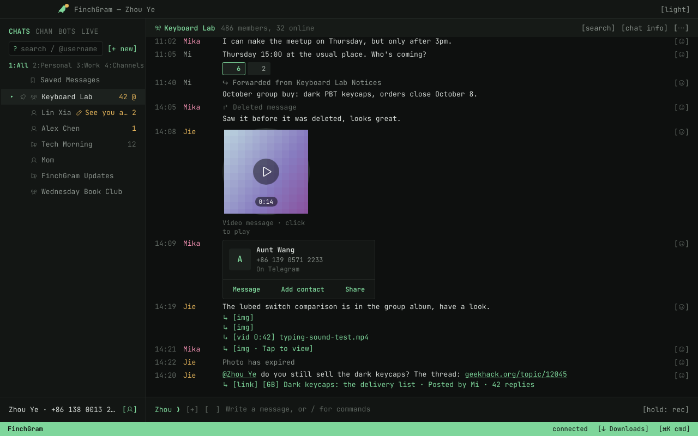

# FinchGram

**English** · [简体中文](readme/zh-Hans.md) · [繁體中文](readme/zh-Hant.md) · [Español](readme/es.md) · [Português](readme/pt.md) · [Deutsch](readme/de.md) · [Français](readme/fr.md) · [Русский](readme/ru.md) · [日本語](readme/ja.md) · [한국어](readme/ko.md) · [العربية](readme/ar.md)

**A Telegram desktop client with superpowers, in Rust and [Slint](https://slint.dev).** Open source
under the GPL-3.0. macOS on Apple silicon today; Windows and Linux later.

FinchGram talks to Telegram through [TDLib](https://core.telegram.org/tdlib), Telegram's own library,
and keeps to the [Telegram API terms](https://core.telegram.org/api/terms). It is an unofficial
client, not made by Telegram.

## What it does

- **Telegram, the way its own apps do it.** Chats with folders, search and up to ten accounts; messages with replies, reactions, bots, topics and drafts; photos, videos, files and voice messages; your groups and channels, managed.
- **A screenshot tool.** ⌘⇧A freezes the screen: take a window or a selection, draw on it, send it. From every chat, as in WeChat.
- **Downloads.** A download client for your own servers over WebDAV, FTP, FTPS or SFTP: a NAS, a seedbox, PikPak. [More](docs/downloads.md)
- **Music.** A player for your own servers that speak the Subsonic API: Navidrome and the like. [More](docs/music.md)
- **Live streams.** Owncast, PeerTube, Icecast and Telegram's own, found, followed and watched in the app. [More](docs/live-streams.md)
- **Voice input.** Speak into the composer, through the AI vendor you choose, under your own key. [More](docs/voice-input.md)
- **AI assistants.** Claude and other MCP apps read your chats and act in them through FinchGram, once you let them. [More](docs/mcp.md)
- **Three themes.** Workbench, Broadsheet and Terminal, each light and dark. Terminal has a real command line. [How to use it](docs/terminal.md)
- **Eleven languages**, and updates the app installs by itself, after verifying them.

[Everything it does, with pictures](docs/features.md). Not there yet: secret chats and calls, polls and scheduled messages, keyword filters, Windows and Linux. See [what comes next](docs/architecture.md#not-now).

## Download

Get `FinchGram-<version>-macos-arm64.zip` from the latest
[release](https://github.com/FinchGram/FinchGram/releases/latest), unzip it and move FinchGram into
Applications. It needs macOS 12 or newer on Apple silicon. The app is signed with North Brookville LLC's
Developer ID and notarized by Apple, so it opens like any other app. From then on it updates
itself.

Every release comes with `SHA256SUMS` and its Ed25519 signature. The app checks both before it
installs an update; so can you, with the public key in [release-signing.pub](release-signing.pub).

## Three themes

| Workbench | Broadsheet | Terminal |
|---|---|---|
|  |  |  |

Workbench, the default, is a working window with tabs. Broadsheet reads like a newspaper, with an
accent colour per account. Terminal is a monospace screen with commands. Each has a light and a dark
side, following the system or your choice, in Settings → Appearance.

Terminal runs commands from the line at its foot: press ⌘K, or type `/`. [The Terminal theme](docs/terminal.md) has the commands and the keys.

## Telegram's rules

FinchGram does what Telegram's own apps do, and nothing they forbid. A message is marked read when
you see it, the other side sees you typing and online as in any Telegram app, sponsored messages in
channels are shown, self-destructing media opens once, and nothing from Telegram goes to any AI
unless you let an assistant in (Toolbox → AI access) or turn on transcribing voice messages with
your own AI vendor. Nothing leaves your machine except to Telegram, to GitHub for updates, and, while
you use voice input, your voice to the AI vendor you chose, under your own key.

## Documentation

- [What FinchGram does](docs/features.md): every feature, with pictures.
- [The Terminal theme](docs/terminal.md): its command line and its commands.
- [Building from source](docs/development.md), [the repository's layout](docs/layout.md), [translations](docs/translations.md) and [releases](docs/releases.md).
- [Architecture](docs/architecture.md) and [conventions](docs/conventions.md): how it is built, and why.

## Development

The app is a shell: Telegram itself is done by TDLib, which runs as a separate program beside it and is built from pinned sources by this repository, as libmpv and Skia are. Building needs macOS on Apple silicon and a Telegram API ID of your own; the steps are in [docs/development.md](docs/development.md).

## Contributing

Issues and pull requests are welcome. Before changing how things fit together, read
[docs/architecture.md](docs/architecture.md) and [docs/conventions.md](docs/conventions.md): every
dependency is built from pinned sources by this repository, the UI follows the design in all three
themes, and nothing in the app goes against Telegram's API terms. Keep `cargo test`,
`cargo clippy --all-targets` and `cargo test screenshots -- --ignored` clean, and look at the
pictures. The READMEs' own pictures come from that test too: `scripts/readme-pictures.sh` refreshes
`docs/screenshots/`.

## License

GPL-3.0 ([LICENSE](LICENSE)). finchgram-tdlib contains TDLib (Boost Software License 1.0) and
OpenSSL (Apache License 2.0); the UI fonts are under the SIL Open Font License 1.1, the icons under
the MIT license. Their licence texts travel with the app.
