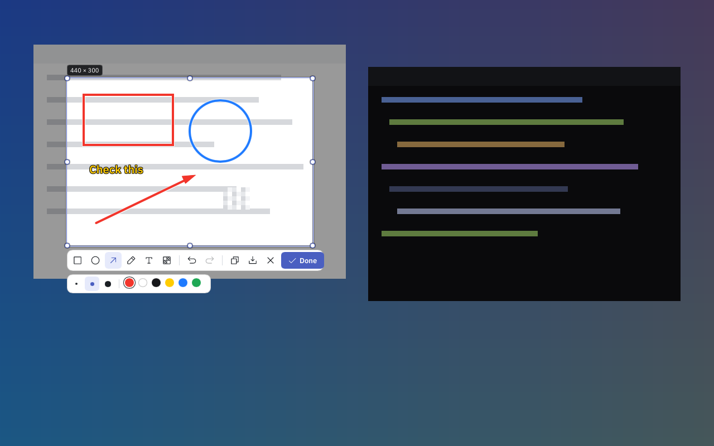
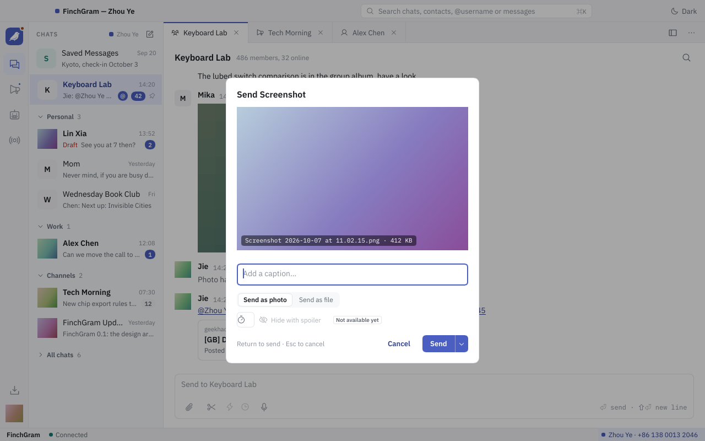
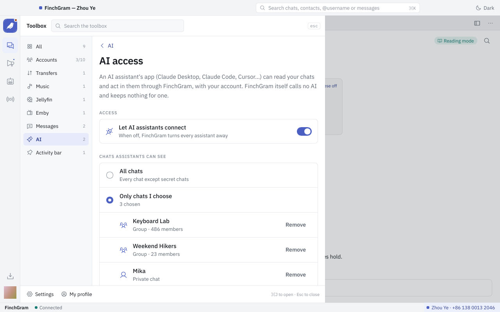
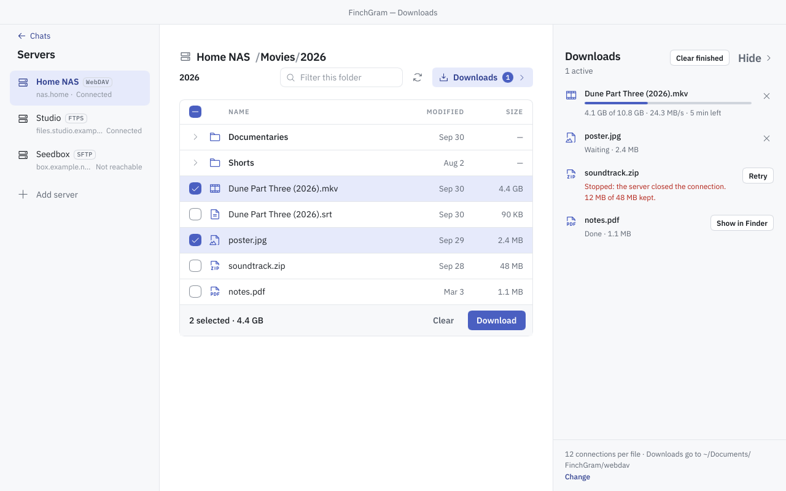
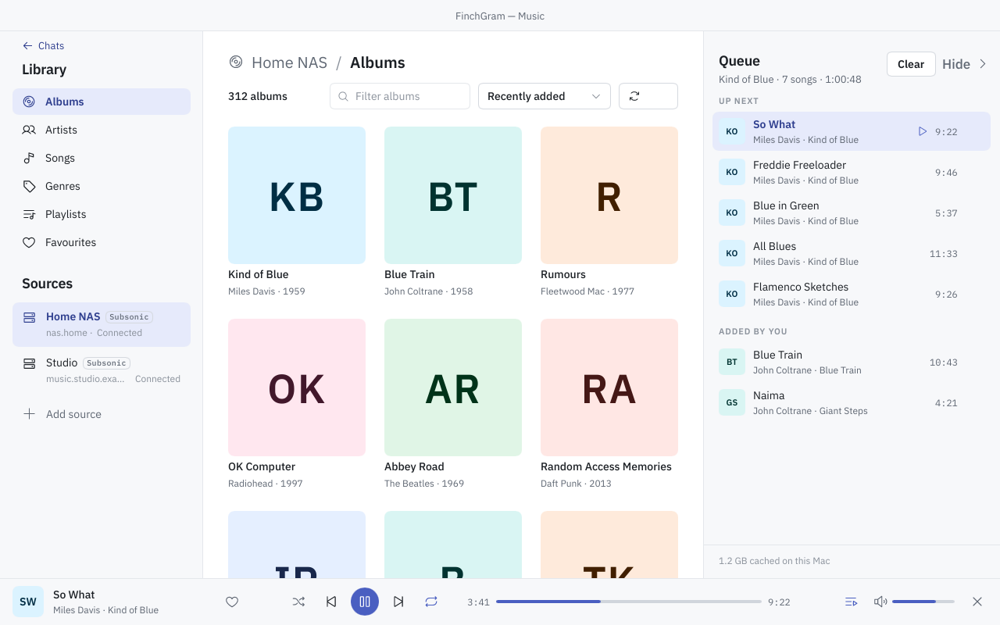
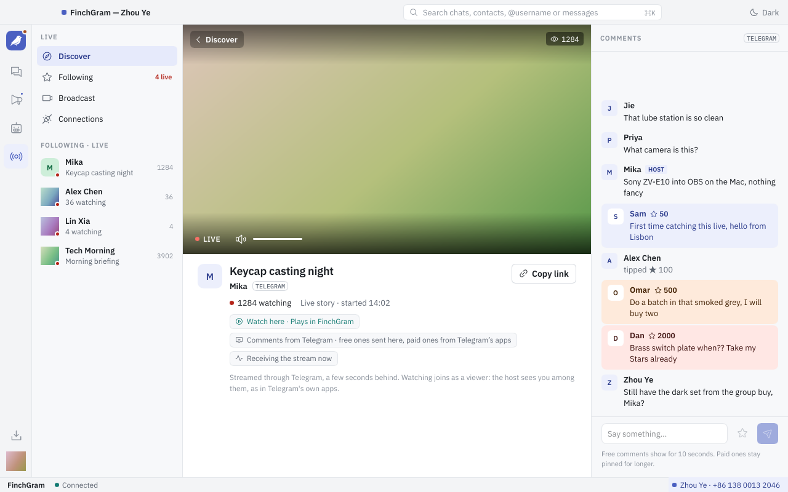

# What FinchGram does

[中文](features.zh-Hans.md)

Everything FinchGram does today. The Terminal theme has a page of its own, [terminal.md](terminal.md); how the app is put together is in [architecture.md](architecture.md).

- **Chats.** Log in with your phone number, the code and your two-step password, or by scanning a
  QR code; sign up for a new account. The chat list with Telegram's folders, pinned chats, unread
  counts and mentions; a search over everything (⌘K): your chats and contacts, public users, groups
  and channels by username, people by phone number, and messages; a search within a chat (⌘F); a
  view of your channels and one of your bots. The pencil makes a new group, channel or chat, or adds
  a contact.
  Several accounts, up to ten, each with a TDLib of its own: switch from the account menu or with
  ⌘1 … ⌘0.
  Manage your groups and channels: photo, name and description, public username or invite links,
  members and administrators with their rights, member permissions, slow mode, join approval and
  topics; a channel's signatures and discussion group.
- **Messages.** Text with its formatting (bold, italic, code, links), replies and forwards, photos,
  videos, GIFs, stickers, files, and a card for a link's preview. A right click on a message gives
  its menu: reply, edit, copy, copy its link, forward, report, delete, or choose several. Photos
  and videos sent to self-destruct are shown blurred and opened once, as in Telegram's own apps.
  Bots' buttons under their messages, their keyboards, commands and menu button; the chat's pinned
  message under the header. A chat that protects its content is left out of screenshots and screen
  recordings while it is in front. Reactions, with a picker and a double click for the default one;
  round video messages played in place; contact cards with Message, Add contact and Share; sharing
  a post or a card to several chats at once; drafts kept per chat and across devices; groups with
  topics open on their topics; slow mode counted down in the composer, and a group's rules or, for
  its administrators, its permissions and options in the chat settings panel.
- **Media.** Photos and videos open in a viewer over the window, with the rest of their album;
  video plays through mpv, built from source. Saving to Downloads where the chat allows it.
- **Downloads.** A download client in the media center, over WebDAV, FTP, FTPS or SFTP: your NAS, a seedbox,
  PikPak, Alist/OpenList or a folder shared with `vget serve`, browsed in the app. Files come over several connections at
  once and go on after a stop; photos and videos open in the viewer when they arrive; passwords
  stay sealed in FinchGram's database. See [downloads.md](downloads.md).
- **Music.** A music player for your own servers: add a Navidrome, gonic, LMS, Ampache, Nextcloud Music or Koel server (anything that speaks the Subsonic API) and play its library in the built-in player, gapless, with a queue and a player bar at the foot of every page; songs are cached as they play.
- **Live streams.** A view of its own beside chats, channels and bots: discover who is live on Owncast and PeerTube servers, Icecast stations and Telegram channels, follow them, and watch in the app, with Owncast's chat beside the picture. Telegram's own are there too: your contacts' and channels' live stories, and the live streams and video chats of your chats, with their comments. Go live with a live story or a channel's live stream: FinchGram gives you the address and key to put into OBS.
- **Sending.** Photos, videos and files from the paperclip, by dragging them onto the window, or by
  pasting them. A card shows them before they go: with a caption, as a photo or as a file, together
  as an album of up to ten, with a self-destruct timer in a private chat, without sound.
- **Screenshots.** The scissors in the composer, or ⌘⇧A, freeze the screen: take a window or drag a
  selection, draw rectangles, ellipses, arrows, pen strokes, text and mosaic on it, then send it,
  copy it or save it. As in WeChat, from every chat.
- **A chat's menu.** Mute, pin, copy its ID, put it into a folder; block or unblock a person,
  report, leave a group or channel, delete a chat. A right click on a folder marks all of its
  chats as read, or sorts the chats: by the latest message, by name, or by unread messages, the
  pinned ones staying on top.
- **Notifications.** New messages come as macOS notifications and their number sits on the Dock
  icon; FinchGram stays in the Dock when its window closes, and can live in the menu bar.
- **Three themes.** Workbench, Broadsheet and Terminal, each light and dark, switched without a
  restart.
- **Settings.** Launch at login, Send with Enter, the screenshot shortcut, notification sounds and
  previews, two-step verification, the interface language, and updates: the app updates itself from
  GitHub Releases and installs nothing it cannot verify.
- **Voice messages.** Play them in the chat, with their waveform, the time and 1×, 1.5× or 2×;
  listening tells the sender, as in Telegram's own apps. Hold the microphone to record one: let go
  to send it, drag left to cancel, drag up to lock it, then stop it to listen before it goes.
- **Voice input.** Press the sparkle in the composer and speak: the words go into the box for you to
  send. You add your AI vendors, each a name, an API format, your own key and, if you like, your own
  address (a relay, or a server on your network). Voice input, tidying its words of um and uh, and
  transcribing voice messages are three features, each with its own switch, and you choose each
  one's AI vendor and model from lists; nothing is chosen for you. For speech: OpenAI's realtime
  transcription, Qwen and Doubao (both strong in Chinese), or any service that speaks OpenAI's
  transcription API; for tidying: OpenAI's, Anthropic's or Gemini's format. Words of other languages
  mixed in are kept as you say them. Toolbox → AI → Voice input, off until you turn it on.
  Transcribe under a voice message uses Telegram's own transcription, or, once you turn that on,
  your own AI vendor. See [voice-input.md](voice-input.md).
- **AI assistants.** Claude Desktop, Claude Code and other apps that speak the Model Context
  Protocol can read your chats and act in them through FinchGram, once you let them: Toolbox → AI access, off until you turn it on, with the chats you choose and whether an assistant may send, and
  a question the first time an app connects. See [mcp.md](mcp.md).
- **Languages.** The interface and this README in eleven languages.

Not there yet: secret chats and calls, polls and scheduled messages, keyword
filters, Windows and Linux. See [what comes next](architecture.md#not-now).

## The screenshot tool

Press ⌘⇧A, or the scissors next to the paperclip. The screen freezes, dimmed, under an overlay: you
drag a selection, with a magnifier and the size in pixels, or click a window to take it whole. The
toolbar draws rectangles, ellipses, arrows, pen strokes, text and mosaic, in three sizes and six
colours, with undo. Done puts the picture into the send card, where a caption can go with it; ⌘C
copies it; ⌘S saves it to Downloads. Settings → General → Screenshots holds the shortcut and
whether the FinchGram window hides meanwhile.

## AI assistants

FinchGram is an MCP server: an AI assistant's app on your Mac (Claude Desktop, Claude Code, Cursor…)
can read your Telegram and act in it through the running app, with your own account. Toolbox → AI access is the switch, off by default. There you choose which chats an assistant may see (all but
secret chats, or only chosen ones) and what it may write (messages under your name, drafts only for
you to send, or nothing), and you see which apps have connected, with their names as macOS reports
them, and what they asked for. The first time an app connects, FinchGram asks whether to allow it.
Reading marks nothing as read, secret chats are never shown, and nothing is kept for an AI. The page
gives the line to paste into Claude Code or Claude Desktop; [mcp.md](mcp.md) has the
details.

## The Downloads page

View → Downloads, or the download icon above the gear. Add a server over WebDAV, FTP, FTPS or SFTP (a
NAS, a seedbox, PikPak, Alist/OpenList, Nextcloud, `rclone serve webdav`, or a folder shared with `vget serve`),
browse its folders, tick files or take a whole folder, and they arrive in ~/Documents/FinchGram/webdav:
each file in 8 MB chunks over up to twelve connections, going on from where it stopped after a
Retry, as the maintainer's command-line tool vget does. The queue on the right shows the speed and
what is left; Open fetches a photo or video and shows it in the viewer. FinchGram changes nothing
on a server unless you allow it for that server (then it can delete, move, rename and upload
there), and the password goes sealed into FinchGram's database, never into a plain file.
[downloads.md](downloads.md) has the details and what is not there yet (a self-signed
certificate is refused: use http on the LAN, or a real certificate).

## The Music page

View → Music, or the toolbox's Music. Add a source: a server of your own that speaks the Subsonic API (Navidrome, gonic, LMS, Ampache, Nextcloud Music, Koel…), its address and your account; the password is kept sealed in FinchGram's database. Browse its albums, artists, songs, genres, playlists and favourites, play or shuffle an album, add songs to the queue; stars go back to the server. Songs come through FinchGram's own HTTP client into `~/Documents/FinchGram/music_cache` and play as they arrive, one after another without a gap; the player bar stays at the foot of every page. [music.md](music.md) has the details.

## Live streams

The fourth entry on the left, beside chats, channels and bots (LIVE in Terminal, or /live), is a live client over several sources, and needs your Telegram login. **Discover** searches the directory at services.finchgram.com ([live-directory.md](live-directory.md), an open, read-only JSON API that anyone may serve, change by pull request, or fork and run): the Owncast and PeerTube channels live now, from those projects' own opt-in directories, Icecast stations from Xiph's, and reviewed HLS streams and Telegram channels, by source, category, language and status, as cards or a list. **Following** keeps the channels you follow here, and the live streams you follow on Telegram count too. **Watch** plays a stream in the app, through FinchGram's own libmpv, with a choice of quality, the live edge, a mini player while you look elsewhere, and a window that stays on top of other apps; Owncast's chat is read and sent beside the picture, under the name Owncast gives you, never your Telegram name. **Connections** opens a link: an Owncast or PeerTube page, an Icecast station, an HLS playlist or a Telegram channel. **Broadcast** puts your live story, or a channel's live stream, on Telegram and shows the server and key for OBS; your own stream opens as its host, with its viewers, Stars, top supporters, deleting comments and the end.

Telegram's own streams are in the same view: the live stories of your contacts and of the channels you follow, and the live streams and video chats in your chats; a red dot sits on the entry while somebody is live, and a chat that is live says so in the chat list and under its header. FinchGram has no WebRTC: it plays what Telegram sends as a stream, which is every stream sent over RTMP (OBS, XSplit, ffmpeg); a stream from a phone's camera is listed for the phone. Watching joins the stream as a viewer, as in Telegram's own apps; you write free comments here, and paid ones show in their colours, sending them left to Telegram's own apps for now. Mature-rated channels stay hidden until you show them in Settings › Live, and adult streams are not listed at all; Twitch, YouTube, Kick and Bilibili are not integrated yet. [live-streams.md](live-streams.md) has the details.
