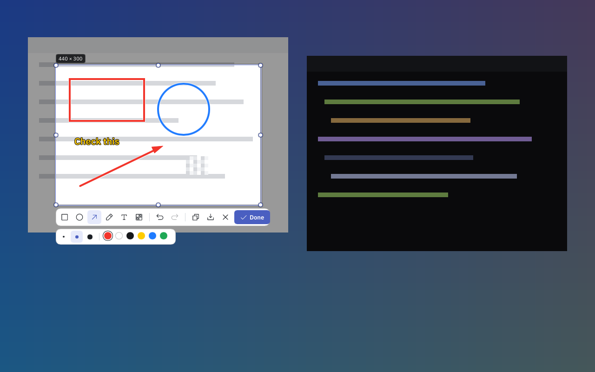
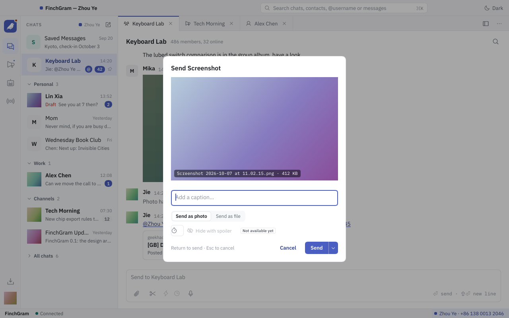
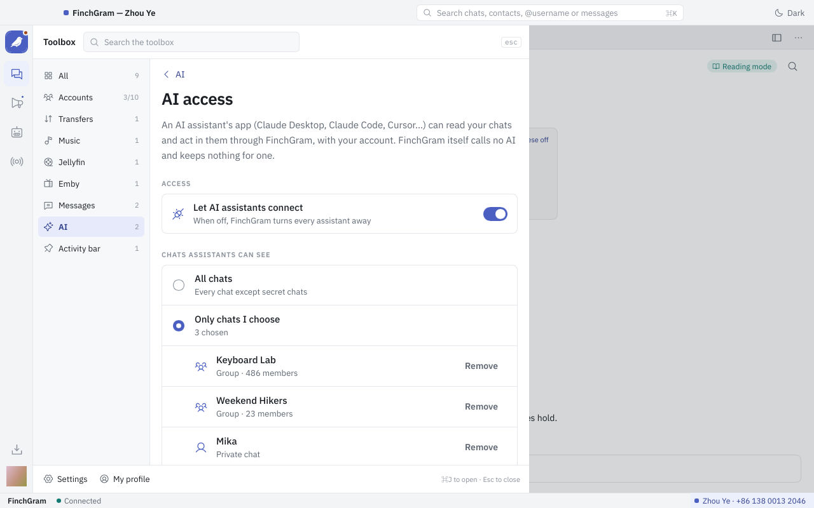
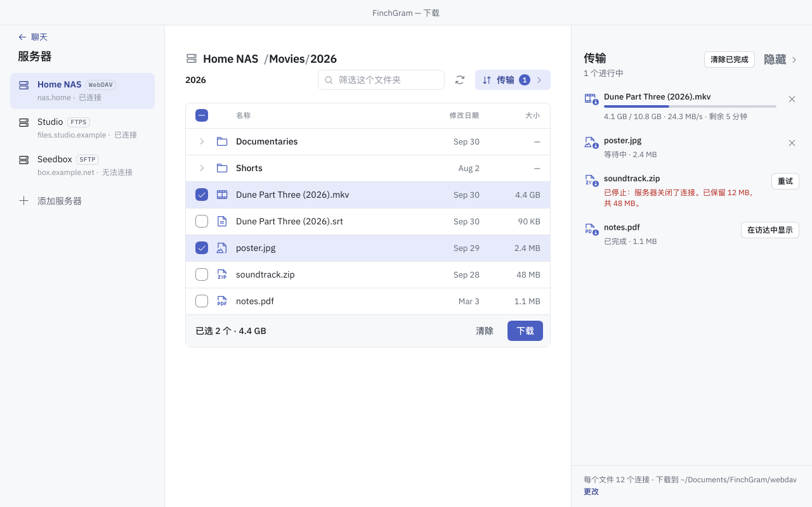
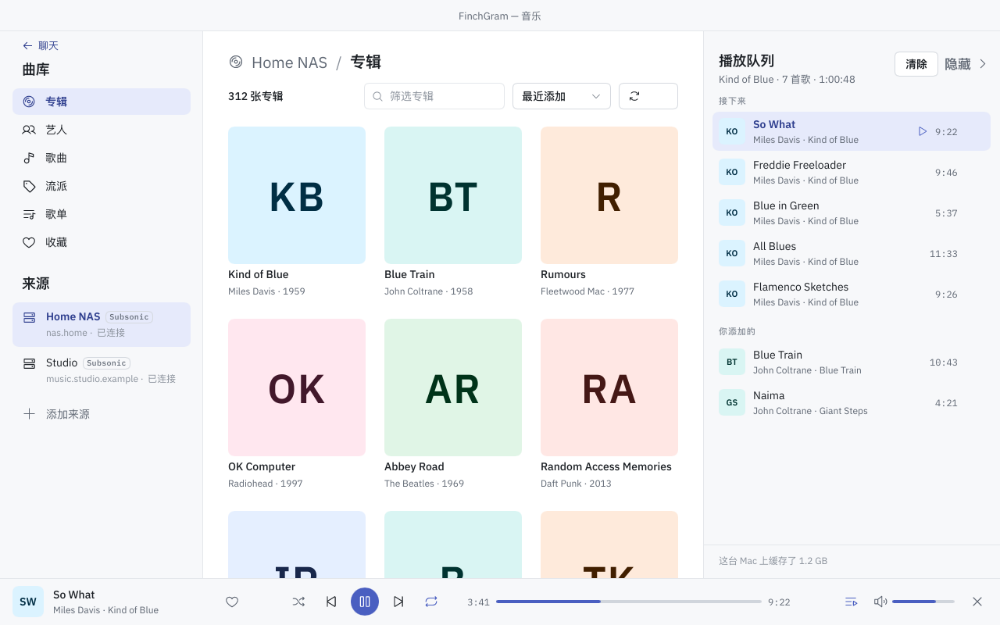
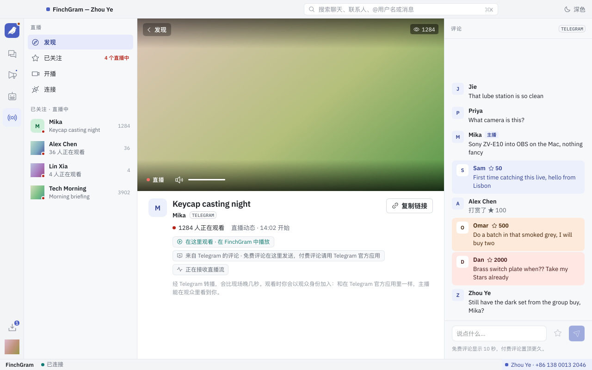

# FinchGram 能做什么

[English](features.md)

FinchGram 现在的全部功能。终端主题单独有一页：[terminal.zh-Hans.md](terminal.zh-Hans.md)；app 是怎么搭起来的见 [architecture.zh-Hans.md](architecture.zh-Hans.md)。

- **聊天。** 用手机号、验证码和两步验证密码登录，或者扫二维码登录；也可以注册新账号。聊天列表带 Telegram
  的文件夹、置顶、未读数和 @ 提醒；全局搜索（⌘K）能找聊天和联系人、按用户名找公开的用户、群组和频道、按手机号找人，
  以及消息；还有聊天内搜索（⌘F）、频道视图和机器人视图。点铅笔可以新建群组、频道、私聊，或添加联系人。
  多账号，最多十个，每个账号各自一个 TDLib：在账号菜单里切换，或按 ⌘1 … ⌘0。
  管理群组和频道：头像、名字和简介、公开用户名或邀请链接、成员和管理员及其权限、成员权限、慢速模式、入群审批和话题；频道的签名和评论群。
- **消息。** 带格式的文字（粗体、斜体、代码、链接）、回复和转发、照片、视频、GIF、贴纸、文件，以及链接预览卡片。
  在消息上点右键打开它的菜单：回复、编辑、拷贝、拷贝链接、转发、举报、删除，或者选择多条。设为自毁的照片和视频
  打码显示、只能打开一次，和 Telegram 官方应用一样。机器人消息下面的按钮，以及机器人的键盘、命令和菜单按钮；
  聊天标题下面的置顶消息。保护内容的聊天在前台时，不会出现在截图和录屏里。表情回应，有选择器，双击就用默认的那个；
  圆形视频消息就地播放；联系人名片带“发消息”“添加联系人”和“分享”按钮；帖子或名片可以一次分享给多个聊天；
  草稿按聊天保存，跨设备同步；开了话题的群打开就是话题列表；慢速模式在输入框里倒计时；
  聊天设置栏里，成员看到群规则，管理员看到权限和选项。
- **媒体。** 照片和视频在盖住整个窗口的查看器里打开，可以翻看同一相册的其他图片；视频用从源码构建的 mpv
  播放。聊天允许时可以保存到“下载”。
- **下载。** 媒体中心里的下载客户端，走 WebDAV、FTP、FTPS 或 SFTP：你的 NAS、seedbox、PikPak、Alist/OpenList，或者用 `vget serve` 共享的
  文件夹，在 app 里直接浏览。文件多连接并发下载，停了能接着来；照片和视频下完直接在查看器里打开；密码封在 FinchGram
  的数据库里。见 [downloads.zh-Hans.md](downloads.zh-Hans.md)。
- **音乐。** 播放你自己服务器上音乐的播放器：添加一个 Navidrome、gonic、LMS、Ampache、Nextcloud Music 或 Koel（任何会说 Subsonic API 的服务器），在内置播放器里播它的曲库，首尾无缝，有队列，播放条在每一页底部；歌边播边缓存。
- **直播。** 在聊天、频道、机器人旁边单独一栏：发现 Owncast 和 PeerTube 服务器、Icecast 电台和 Telegram 频道里此刻谁在直播，关注他们，在应用里观看，Owncast 的聊天就在画面旁边。Telegram 自己的直播也在这里：联系人和你关注的频道的直播动态，以及你的聊天里的直播和视频聊天，连同评论。也可以开播：自己的直播动态，或频道的直播，FinchGram 给出填进 OBS 的地址和密钥。
- **发送。** 照片、视频和文件可以从回形针菜单发送，也可以拖进窗口或直接粘贴。发出去之前先在一张卡片里显示：
  可以加说明文字，按照片发或按文件发，最多十个合成一个相册，私聊里可以设自毁计时器，也可以静默发送。
- **截图。** 输入栏里的剪刀或 ⌘⇧A 会定住屏幕：取一个窗口或拖一个选区，画上方框、椭圆、箭头、画笔、文字和马赛克，
  然后直接发送、复制或保存。和微信一样，每个聊天里都有。
- **聊天菜单。** 静音、置顶、复制 ID、放进文件夹；拉黑或取消拉黑对方、举报、退出群组或频道、删除聊天。
  在文件夹上点右键，可以把里面的聊天全部标为已读，或者选择排序方式：按最新消息、按名称、按未读消息，
  置顶的始终在最前。
- **通知。** 新消息以 macOS 通知提醒，未读数显示在 Dock 图标上；关闭窗口后 FinchGram 留在 Dock 里，也可以住进菜单栏。
- **三套主题。** 工作台、报纸和终端，各有浅色和深色，切换不用重启。
- **设置。** 开机启动、按 Enter 发送、截图快捷键、通知的声音和预览、两步验证、界面语言，还有更新：app 从
  GitHub Releases 自动更新，验证不过的一律不装。
- **语音消息。** 在聊天里直接播放，带波形、时长和 1×、1.5×、2× 倍速；听过对方能看到，和 Telegram 官方应用一样。按住麦克风录音：松开发送，向左拖取消，向上拖锁定，锁定后可以停下来先试听再发。
- **语音输入。** 在输入框里按一下 ✦ 然后说话，字进到输入框里，由你来发送。你添加自己的 AI 服务商，每个有名字、API 格式、你自己的密钥，愿意的话还可以填自己的地址（中转站，或局域网里的服务器）。语音输入、整理文字（去掉“嗯”“呃”）、语音消息转文字是三个功能，各有各的开关，每个功能用哪个 AI 服务商、哪个模型都由你从列表里选，不替你选任何东西。语音识别可以用 OpenAI 的实时转写、通义千问和豆包（中文都很强），或任何支持 OpenAI 转写接口的服务；整理文字用 OpenAI、Anthropic 或 Gemini 的格式。夹杂的其他语言照你说的原样保留。百宝箱 → AI → 语音输入，默认关着。语音消息下面的“转文字”用 Telegram 自己的转写，你打开开关后改用你自己的 AI 服务商。见 [voice-input.zh-Hans.md](voice-input.zh-Hans.md)。
- **AI 助手。** Claude Desktop、Claude Code 以及其他会说 Model Context Protocol 的应用，可以在你允许后通过 FinchGram 读你的聊天并代你操作：百宝箱 → AI 访问，默认关着，由你选哪些聊天、助手能不能发消息，应用第一次连接时会先问你。见 [mcp.zh-Hans.md](mcp.zh-Hans.md)。
- **语言。** 界面和这份 README 都有十一种语言。

还没有的：秘密聊天和通话、投票和定时消息、关键词过滤、Windows 和 Linux。见
[接下来做什么](architecture.zh-Hans.md#现在不做)。

## 截图工具

按 ⌘⇧A，或者点回形针旁边的剪刀。屏幕定住，整屏压暗：拖一个选区，选区内不压暗，带放大镜和像素尺寸；
单击一个窗口则整个取下。工具条可以画方框、椭圆、箭头、画笔、文字和马赛克，三种粗细、六种颜色，可以撤销。
点 Done 把图放进发送卡片，可以配上说明文字；⌘C 复制；⌘S 存到“下载”。“设置 › 通用 › 截图”里可以改快捷键，
也可以决定截图时要不要先把 FinchGram 的窗口藏起来。

## AI 助手

FinchGram 是一个 MCP 服务端：你 Mac 上的 AI 助手应用（Claude Desktop、Claude Code、Cursor……）可以通过正在运行的 FinchGram、用你自己的账号读你的 Telegram 并在其中操作。百宝箱 → AI 访问 是开关，默认关着。在那里你选助手能看到哪些聊天（除秘密聊天外的全部，或只限选定的）、能写什么（以你的名义发消息、只留草稿由你发、或什么都不写），也能看到哪些应用连接过——名字是 macOS 报告的——以及它们要过什么。应用第一次连接时，FinchGram 会问你允不允许。读取不会标已读，秘密聊天永远不给看，也不为 AI 保存任何东西。页面上备好了贴进 Claude Code 或 Claude Desktop 的那一行；细节见 [mcp.zh-Hans.md](mcp.zh-Hans.md)。

## 下载页面

显示 → 下载，或者齿轮上方的下载图标。添加一个服务器，WebDAV、FTP、FTPS 或 SFTP（NAS、seedbox、PikPak、Alist/OpenList、Nextcloud、
`rclone serve webdav`，或者用 `vget serve` 共享的文件夹），浏览它的文件夹，勾选文件或整个文件夹拿走，文件就到了
~/Documents/FinchGram/webdav：每个文件切成 8 MB 的块、最多十二条连接并发，重试时从停下的地方接着来，和维护者的命令行
工具 vget 一个做法。右边的队列显示速度和还剩多少；“打开”把照片或视频取下来后在查看器里显示。除非你为某台服务器允许，FinchGram 不会改动
服务器上的任何东西（允许后可以在那台上删除、移动、重命名、上传）；密码封起来进 FinchGram 的数据库，从不以明文写进文件。细节和还没做的部分见 [downloads.zh-Hans.md](downloads.zh-Hans.md)
（自签名证书会被拒绝：局域网用 http，或者配正规证书）。

## 音乐页面

显示 → 音乐，或百宝箱里的音乐。添加一个来源：你自己的、会说 Subsonic API 的服务器（Navidrome、gonic、LMS、Ampache、Nextcloud Music、Koel……），填地址和账号；密码封存在 FinchGram 的数据库里。浏览它的专辑、艺术家、歌曲、流派、歌单和收藏，播放或随机播放一张专辑，把歌加进队列；打星会写回服务器。歌通过 FinchGram 自己的 HTTP 客户端进到 `~/Documents/FinchGram/music_cache`，边到边播，首尾无缝；播放条留在每一页的底部。详见 [music.zh-Hans.md](music.zh-Hans.md)。

## 直播

左侧第四个入口，在聊天、频道、机器人旁边（Terminal 里是 LIVE，或 /live），是一个汇集多个来源的直播客户端，要登录 Telegram 才能用。**发现**搜索 services.finchgram.com 上的直播目录（[live-directory.zh-Hans.md](live-directory.zh-Hans.md)，一个开放的只读 JSON API，谁都可以提供，可以用 PR 改动，也可以 fork 走自己运行）：此刻在播的 Owncast 和 PeerTube 频道（来自这两个项目各自的自愿登记目录）、Xiph 目录里的 Icecast 电台，以及审核过的 HLS 直播流和 Telegram 频道；可以按来源、分类、语言和状态筛选，以卡片或列表显示。**已关注**保存你在这里关注的频道，你在 Telegram 上关注的直播也算在内。**观看**用 FinchGram 自带的 libmpv 在应用里播放：可以选清晰度、回到直播最新处，去看别的页面时有小窗接着播，还能弹出一个始终在其他应用之上的窗口；Owncast 的聊天在画面旁边，能看也能发，用的是 Owncast 给你的名字，从不用你的 Telegram 名字。**连接**打开一个链接：Owncast 或 PeerTube 的页面、Icecast 电台、HLS 播放列表或 Telegram 频道。**开播**会把你的直播动态或频道直播开在 Telegram 上，并给出填进 OBS 的服务器地址和密钥；你自己的直播以主播身份打开，能看到观看人数、Stars、打赏榜，能删评论、结束直播。

Telegram 自己的直播也在这个视图里：联系人和你关注的频道的直播动态，以及你的聊天里的直播和视频聊天；有人在播时入口上有个红点，正在直播的聊天在聊天列表里和标题下方也会标出来。FinchGram 没有 WebRTC：它播放 Telegram 以流的形式发来的直播，也就是所有通过 RTMP 推流的直播（OBS、XSplit、ffmpeg）；手机摄像头开的直播会列出来，标着在手机上看。观看就是以观众身份加入，和 Telegram 自己的应用一样；免费评论可以直接写，付费评论按档位上色显示，发付费评论暂时交给 Telegram 自己的应用。限制级频道默认隐藏，可以在 设置 › 直播 里打开；成人直播一律不列出。Twitch、YouTube、Kick 和 Bilibili 还没有接入。详见 [live-streams.zh-Hans.md](live-streams.zh-Hans.md)。
