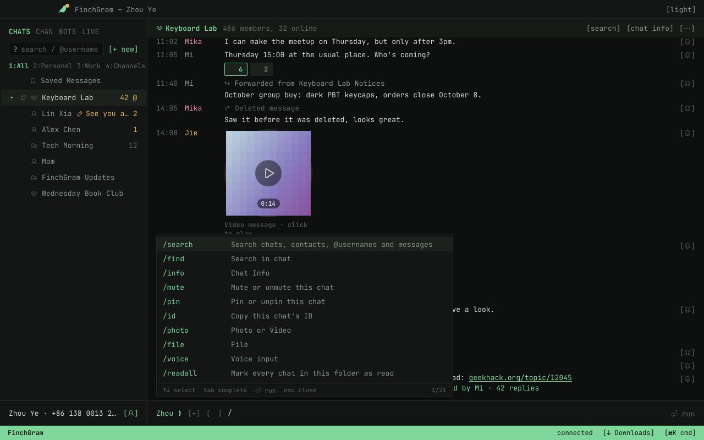
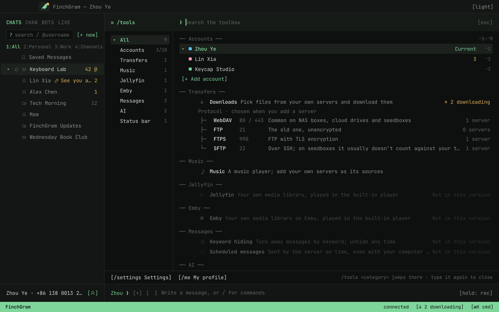

# The Terminal theme

[中文](terminal.zh-Hans.md)

Terminal is one of FinchGram's three themes: a monospace screen, dark unless you choose light, made
for the keyboard. Choose it in Settings → Appearance or in the View menu; nothing restarts, and the
open chat stays open. Everything on it can be clicked, as in the other two themes. What sets it
apart is the line at the foot of the window: it writes messages, and it runs commands.

## The command line

- **Type a message and press Return**, as anywhere else. (Settings → General decides whether Return
  or ⌘Return sends; a command always runs on Return.)
- **Type `/` for the commands.** The ones that can run where you are show above the line, the
  commands of the chat's bot first, in amber, then FinchGram's own, in green.
- **⌘K**, or `[⌘K cmd]` on the status bar, puts the keyboard on the line with `/` already there.
  `/search` is the first command, so ⌘K and Return is the search over everything, as ⌘K is in the
  other themes.
- **↑ ↓** pick a command, **Tab** completes its name, **Return** runs the one that is lit, **Esc**
  gives it up. You need not type a name out: `/se` and Return is `/search`.
- **Words after a name go with it**: `/search keeb`, `/tools ai`.
- A `/word` that is no command of FinchGram's or the bot's is sent to the chat as it is, as
  Telegram's own apps do: `/start@some_bot`.

The line runs commands wherever you are:

| Where | The line |
|---|---|
| A chat you can write to | Messages and commands |
| No chat open, or a group's list of topics | Commands only; it says `/ for commands` |
| A channel you only read, a closed topic | Out of sight while you read. ⌘K brings it for one command; it goes again after the command, at Esc, or when you open another chat |
| The toolbox is open | Commands as before. `/` typed into the toolbox's search goes to the line too |

## The commands

| Command | What it does | Needs |
|---|---|---|
| `/search [words]` | The search over everything: chats, contacts, @usernames, messages | |
| `/find` | The search within this chat (⌘F) | a chat |
| `/info` | The chat's info panel, open or shut (⌘I) | a chat |
| `/mute` | Mutes or unmutes this chat | a chat |
| `/pin` | Pins or unpins this chat | a chat |
| `/id` | Copies this chat's ID | a chat |
| `/photo` | Sends photos or videos: opens the file dialog | a chat that takes them |
| `/file` | Sends files | a chat that takes them |
| `/voice` | Voice input: once to start, again to finish | a chat you can write to |
| `/readall` | Marks every chat of the folder shown as read | |
| `/group` `/channel` `/dm` `/contact` | A new group, channel or chat; a new contact | |
| `/tools [category]` | The toolbox, at a category if you name one (`/tools ai`); the same command again closes it | |
| `/downloads` `/music` `/live` | The Downloads page (⌥⌘L), the Music page (⌥⌘M), the Live view (⇧⌘L) | |
| `/accounts` | The toolbox at your accounts | |
| `/settings` `/me` | Settings (⌘,), your profile | |

A command that cannot run where you are is not listed: with no chat open there is no `/mute`. The
menus show a command beside the entry it stands for (`Mute  /mute`), the way the other themes' menus
show shortcuts.

## The rest of the screen

- **The list at the left.** `CHATS`, `CHAN`, `BOTS` and `LIVE` at its top are the four views; under
  them the search (a click opens it, as `/search` does), `[+ new]`, and your folders as numbered
  tabs. `▸` marks the open chat. A right click on a chat or on a folder gives its menu.
- **The pane.** The chat reads as a log: the time, the name, the words. `[search]`, `[chat info]`
  and `[⋯]` are at its top right; a right click on a message gives its menu; ↑ on an empty line
  edits your last message.
- **The toolbox** (the bird in the title bar, ⌘J, or `/tools`) takes the pane's place: your
  accounts, Downloads, Music, AI access and voice input, with a search of its own and the
  categories at the left. `[x]` in its Status bar category pins a tool to the status bar.
- **The status bar** at the bottom: whether FinchGram is connected, the tools you pinned, and
  `[⌘K cmd]`.
- **Accounts**: ⌘1 … ⌘0, or ⌃1 … ⌃0.

Not there yet: the commands a message's menu shows beside its entries (`/reply`, `/fwd`, `/del` and
the rest) cannot be typed, because the line has no way yet to say which message is meant; they work
from the menu.
