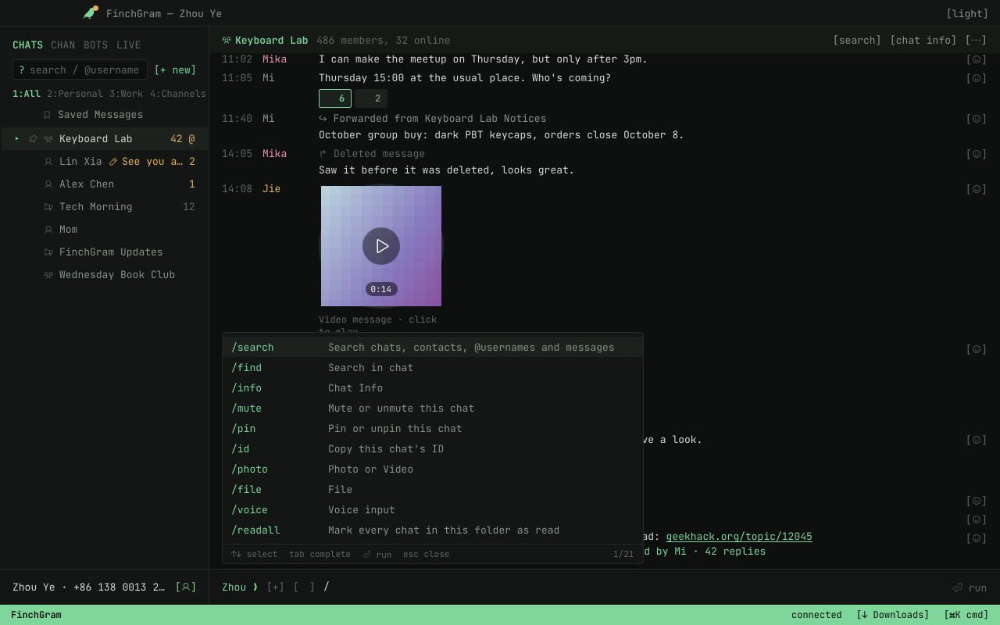
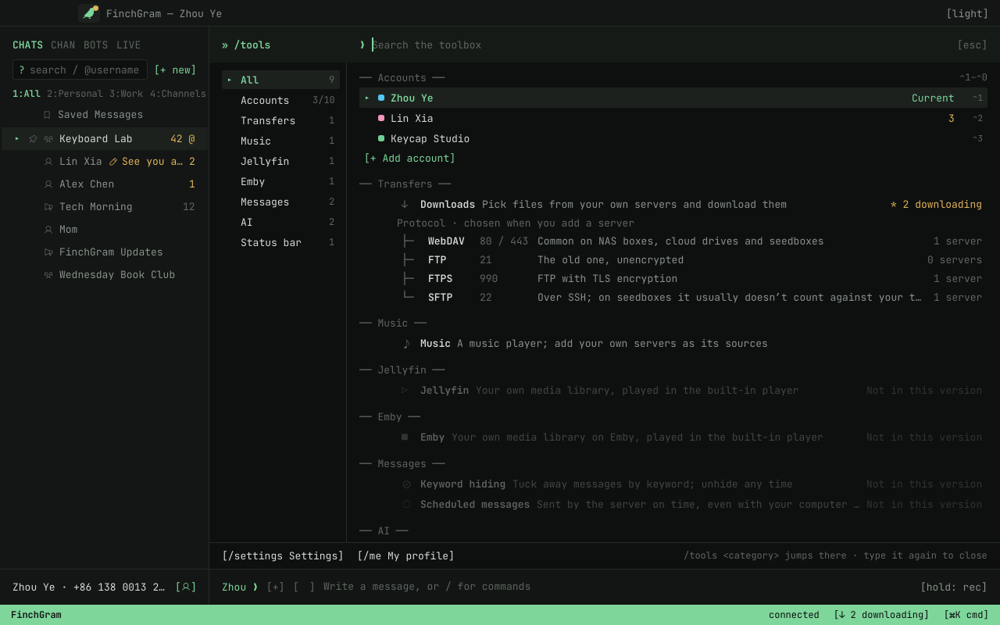

# 终端主题

[English](terminal.md)

终端（Terminal）是 FinchGram 三套主题里的一套：等宽字体，默认深色，为键盘而做。在设置 › 外观，或「视图」
菜单里切换；不用重启，打开的聊天也还在。屏幕上的每样东西都能用鼠标点，和另外两套主题一样。它特别的地方
是窗口最下面那一行：既写消息，也执行命令。

## 命令行

- **输入消息，按回车发送**，和别处一样。（用回车还是 ⌘回车发消息，在设置 › 通用里定；命令永远是回车执行。）
- **输入 `/` 调出命令。** 当前能执行的命令列在这一行上方：先是这个聊天里机器人的命令（琥珀色），再是
  FinchGram 自己的命令（绿色）。
- **⌘K**，或者点底栏的 `[⌘K 命令]`：键盘回到这一行，行上已经放好 `/`。排第一的命令是 `/search`，所以
  ⌘K 再回车就是全局搜索，和另外两套主题里的 ⌘K 一样。
- **↑ ↓** 选命令，**Tab** 补全名字，**回车**执行亮着的那一行，**Esc** 放弃。名字不用打全：`/se` 回车就是
  `/search`。
- **名字后面的字跟着命令走**：`/search keeb`、`/tools ai`。
- 既不是 FinchGram 的命令、也不是机器人命令的 `/词`，原样发到聊天里，和 Telegram 自己的客户端一样：
  `/start@some_bot`。

不管窗口在什么状态，这一行都能执行命令：

| 状态 | 这一行 |
|---|---|
| 打开了能发言的聊天 | 消息和命令都行 |
| 没打开聊天，或者群的话题列表摆着 | 只收命令，占位文字是「输入 / 调出命令」 |
| 只能看的频道、已关闭的话题 | 看的时候不显示。按 ⌘K 把它叫出来执行一条命令；执行完、按 Esc 或换到别的聊天，它就收回去 |
| 百宝箱开着 | 照常执行命令。在百宝箱的搜索里输入 `/`，也会交给这一行 |

## 命令一览

| 命令 | 做什么 | 需要 |
|---|---|---|
| `/search [词]` | 全局搜索：聊天、联系人、@用户名、消息 | |
| `/find` | 在当前聊天里搜索（⌘F） | 有聊天 |
| `/info` | 打开或收起聊天资料面板（⌘I） | 有聊天 |
| `/mute` | 静音或取消静音当前聊天 | 有聊天 |
| `/pin` | 置顶或取消置顶当前聊天 | 有聊天 |
| `/id` | 复制当前聊天的 ID | 有聊天 |
| `/photo` | 发照片或视频：打开文件选择框 | 聊天允许发 |
| `/file` | 发文件 | 聊天允许发 |
| `/voice` | 语音输入：输一次开始，再输一次结束 | 能发言的聊天 |
| `/readall` | 把当前文件夹里的聊天全部标为已读 | |
| `/group` `/channel` `/dm` `/contact` | 新建群组、频道、私聊；添加联系人 | |
| `/tools [分类]` | 百宝箱；带上分类名就直接到那一类（`/tools ai`）；再输一次同样的命令就关闭 | |
| `/downloads` `/music` `/live` | 下载页面（⌥⌘L）、音乐页面（⌥⌘M）、直播（⇧⌘L） | |
| `/accounts` | 百宝箱的账号一类 | |
| `/settings` `/me` | 设置（⌘,）、我的资料 | |

当前状态下执行不了的命令不会列出来：没打开聊天时就没有 `/mute`。菜单里每一项旁边写着它对应的命令
（`静音  /mute`），就像另外两套主题的菜单里写快捷键。

## 屏幕上的其他部分

- **左边的列表。** 顶上的 `CHATS`、`CHAN`、`BOTS`、`LIVE` 是四个视图；下面是搜索（点一下打开，等同
  `/search`）、`[+ 新建]`，以及编了号的文件夹标签。`▸` 标出打开着的聊天。在聊天或文件夹上点右键是它的菜单。
- **窗格。** 聊天像日志一样一行行读：时间、名字、内容。右上角是 `[搜索]`、`[聊天资料]` 和 `[⋯]`；在
  消息上点右键是它的菜单；输入行空着时按 ↑ 是编辑自己的上一条消息。
- **百宝箱**（标题栏的小鸟、⌘J，或 `/tools`）占据窗格的位置：账号、下载、音乐、AI 访问和语音输入，带自己
  的搜索，分类在左边。在「底栏」一类里把工具标成 `[x]`，它就钉到底栏上。
- **底栏**：是否连上了、你钉住的工具，以及 `[⌘K 命令]`。
- **账号**：⌘1 … ⌘0，或 ⌃1 … ⌃0。

还没做到的：消息菜单里每一项旁边写的命令（`/reply`、`/fwd`、`/del` 等）现在还不能输入，因为命令行还没有
办法指明是哪一条消息；它们在菜单里点是能用的。
