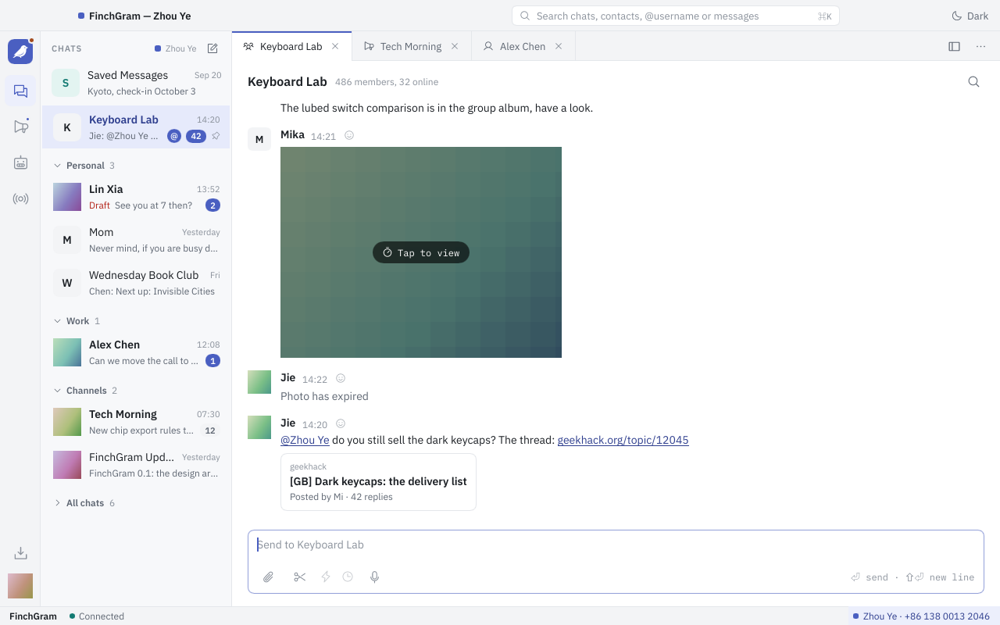

# FinchGram

[English](../README.md) · [简体中文](zh-Hans.md) · [繁體中文](zh-Hant.md) · [Español](es.md) · [Português](pt.md) · [Deutsch](de.md) · [Français](fr.md) · [Русский](ru.md) · [日本語](ja.md) · [한국어](ko.md) · **العربية**

**عميل Telegram لسطح المكتب بقدرات خارقة، مكتوب بـ Rust و[Slint](https://slint.dev).** مفتوح المصدر برخصة GPL-3.0.
اليوم لنظام macOS على Apple silicon؛ وWindows وLinux لاحقًا.

يتواصل FinchGram مع Telegram عبر [TDLib](https://core.telegram.org/tdlib)، مكتبة Telegram نفسها، ويلتزم
[بشروط واجهة Telegram البرمجية](https://core.telegram.org/api/terms). وهو عميل غير رسمي، ليس من صنع Telegram.

## ماذا يفعل

- **Telegram كما في تطبيقاته الرسمية.** دردشات بمجلدات وبحث وحتى عشرة حسابات؛ رسائل بردود وتفاعلات وبوتات ومواضيع ومسودات؛ صور وفيديو وملفات ورسائل صوتية؛ وإدارة مجموعاتك وقنواتك.
- **أداة لقطة الشاشة.** ⌘⇧A يجمّد الشاشة: التقط نافذة أو تحديدًا، ارسم عليها، ثم أرسلها. من أي دردشة، كما في WeChat.
- **التنزيلات.** عميل تنزيل لخوادمك أنت عبر WebDAV أو FTP أو FTPS أو SFTP: NAS أو seedbox أو PikPak. [المزيد](../docs/downloads.md)
- **الموسيقى.** مشغّل لخوادمك التي تتحدث واجهة Subsonic، مثل Navidrome وأشباهه. [المزيد](../docs/music.md)
- **البث المباشر.** Owncast وPeerTube وIcecast وبثّ Telegram نفسه: اكتشفه وتابعه وشاهده داخل التطبيق. [المزيد](../docs/live-streams.md)
- **الإدخال الصوتي.** تكلّم فتدخل الكلمات إلى مربع الكتابة، عبر مزوّد الذكاء الاصطناعي الذي تختاره وبمفتاحك أنت. [المزيد](../docs/voice-input.md)
- **مساعدو الذكاء الاصطناعي.** Claude وتطبيقات MCP الأخرى تقرأ دردشاتك وتتصرف فيها عبر FinchGram، بعد أن تسمح لها. [المزيد](../docs/mcp.md)
- **ثلاث سمات.** Workbench وBroadsheet وTerminal، ولكل منها جانب فاتح وآخر داكن. في Terminal سطر أوامر حقيقي. [طريقة استخدامه](../docs/terminal.md)
- **إحدى عشرة لغة**، وتحديثات يثبّتها التطبيق بنفسه بعد التحقق منها.

[كل ما يفعله، بالصور](../docs/features.md). ليس بعد: الدردشات السرية والمكالمات، الاستطلاعات والرسائل المجدولة، مرشّحات الكلمات المفتاحية، Windows وLinux. انظر [ما يأتي لاحقًا](../docs/architecture.md#not-now).

## التنزيل

احصل على `FinchGram-<version>-macos-arm64.zip` من [أحدث إصدار](https://github.com/FinchGram/FinchGram/releases/latest)، وفكّ
ضغطه وانقل FinchGram إلى «التطبيقات». يحتاج إلى macOS 12 أو أحدث على Apple silicon. التطبيق موقّع بـ Developer ID
الخاص بشركة North Brookville LLC وموثّق من Apple، لذا يُفتح كأي تطبيق آخر. وبعدها يحدّث نفسه.

يأتي كل إصدار مع `SHA256SUMS` وتوقيعه Ed25519. يتحقق التطبيق منهما قبل تثبيت أي تحديث؛ ويمكنك أنت أيضًا، بالمفتاح
العام في [release-signing.pub](../release-signing.pub).

## ثلاث سمات

| Workbench | Broadsheet | Terminal |
|---|---|---|
|  |  |  |

Workbench، السمة الافتراضية، نافذة عمل بعلامات تبويب. وBroadsheet تُقرأ كصحيفة، بلون مميز لكل حساب. وTerminal شاشة
بخط ثابت العرض مع أوامر. لكل منها جانب فاتح وآخر داكن، تبعًا للنظام أو لاختيارك، في الإعدادات ← المظهر.

ينفّذ Terminal الأوامر من السطر أسفل النافذة: اضغط ⌘K أو اكتب `/`. الأوامر والمفاتيح في [سمة Terminal](../docs/terminal.md).

## قواعد Telegram

يفعل FinchGram ما تفعله تطبيقات Telegram نفسها، ولا شيء مما تحظره. تُعلَّم الرسالة كمقروءة حين تراها، ويرى الطرف الآخر
أنك تكتب وأنك متصل كما في أي تطبيق Telegram، وتُعرض الرسائل المموّلة في القنوات، وتُفتح الوسائط ذاتية التدمير مرة
واحدة، ولا يذهب شيء من Telegram إلى أي ذكاء اصطناعي إلا إذا أدخلت مساعدًا بنفسك (الأدوات → وصول الذكاء الاصطناعي) أو شغّلت تحويل الرسائل الصوتية إلى نص بمزوّد الذكاء الاصطناعي الخاص بك. لا يغادر جهازك شيء إلا إلى Telegram، وإلى GitHub من أجل
التحديثات، وصوتك إلى مزوّد الذكاء الاصطناعي الذي اخترته بمفتاحك الخاص حين تستخدم الإدخال الصوتي.

## التوثيق

المستندات مكتوبة بالإنجليزية والصينية.

- [ماذا يفعل FinchGram](../docs/features.md): كل ميزة، بالصور.
- [سمة Terminal](../docs/terminal.md): سطر أوامرها وأوامرها.
- [البناء من المصدر](../docs/development.md)، و[بنية المستودع](../docs/layout.md)، و[الترجمات](../docs/translations.md)، و[الإصدارات](../docs/releases.md).
- [المعمارية](../docs/architecture.md) و[الأعراف](../docs/conventions.md): كيف بُني، ولماذا.

## التطوير

التطبيق غلاف: Telegram نفسه تتولاه TDLib، التي تعمل برنامجًا مستقلًا بجانبه ويبنيها هذا المستودع من مصادر مثبّتة، وكذلك libmpv وSkia. يحتاج البناء إلى macOS على Apple silicon وإلى API ID خاص بك من Telegram؛ والخطوات في [docs/development.md](../docs/development.md).

## المساهمة

المشكلات وطلبات السحب مرحّب بها. قبل تغيير طريقة تركيب الأجزاء، اقرأ [docs/architecture.md](../docs/architecture.md)
و[docs/conventions.md](../docs/conventions.md): كل اعتمادية يبنيها هذا المستودع من مصادر مثبّتة، والواجهة تتبع التصميم في
السمات الثلاث، ولا شيء في التطبيق يخالف شروط واجهة Telegram البرمجية. أبقِ `cargo test` و`cargo clippy --all-targets`
و`cargo test screenshots -- --ignored` نظيفة، وانظر إلى الصور. صور ملفات README تأتي من ذلك الاختبار أيضًا:
`scripts/readme-pictures.sh` يحدّث `docs/screenshots/`.

## الترخيص

GPL-3.0 ([LICENSE](../LICENSE)). يحتوي finchgram-tdlib على TDLib (Boost Software License 1.0) و
OpenSSL (Apache License 2.0)؛ وخطوط الواجهة مرخّصة بـ SIL Open Font License 1.1، والأيقونات بترخيص MIT.
وترافق نصوص تراخيصها التطبيق.
