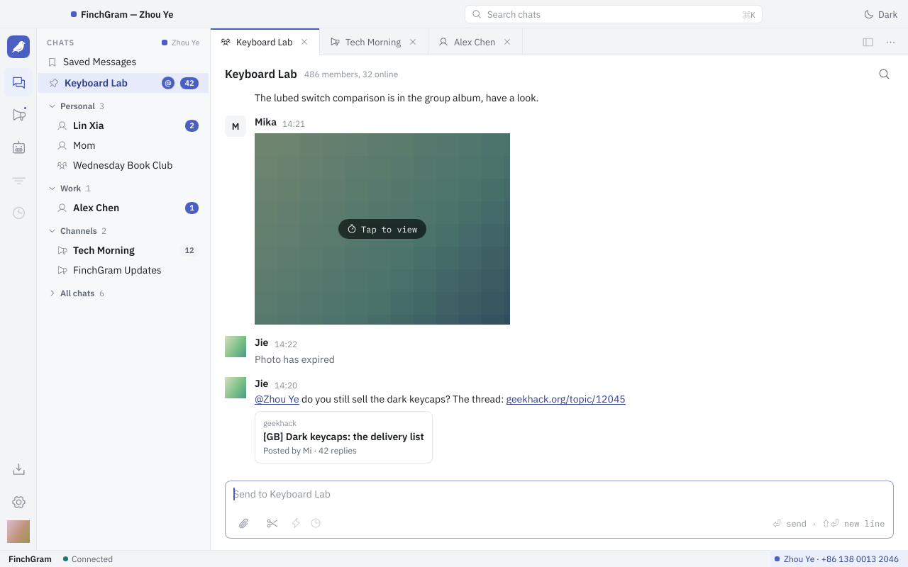
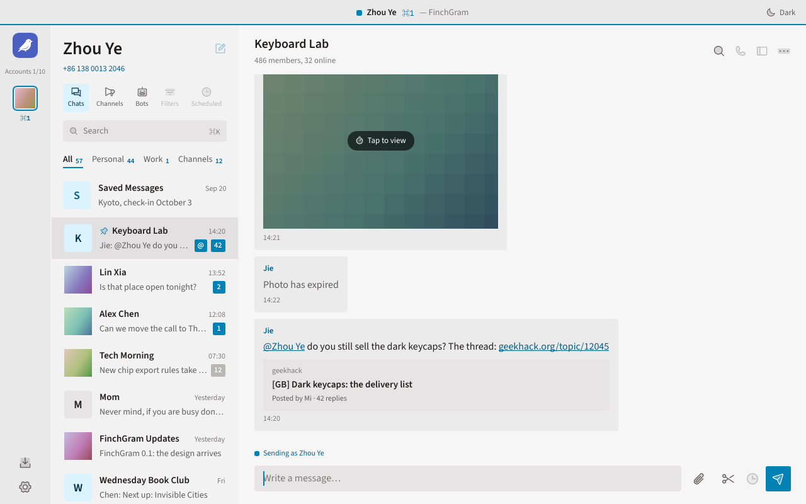
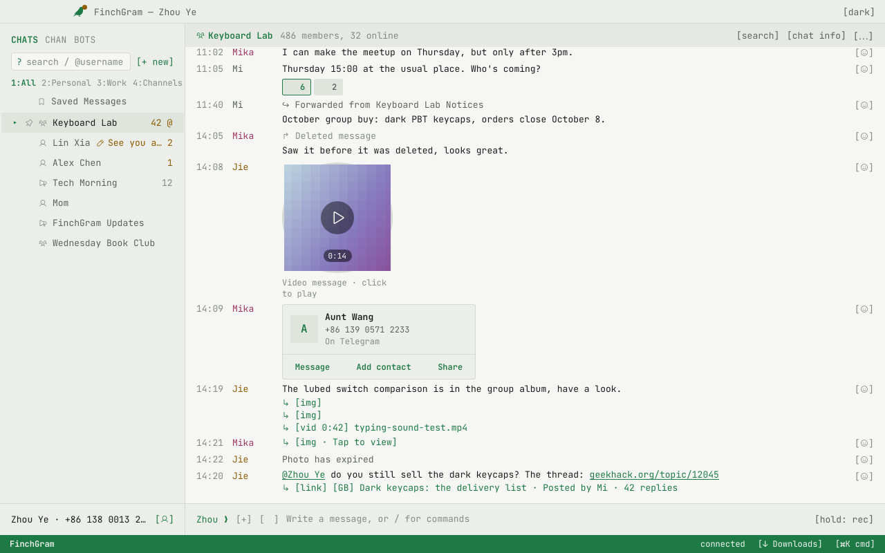
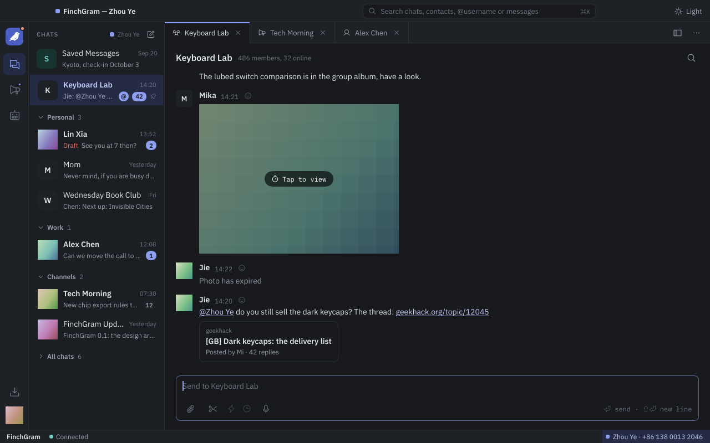
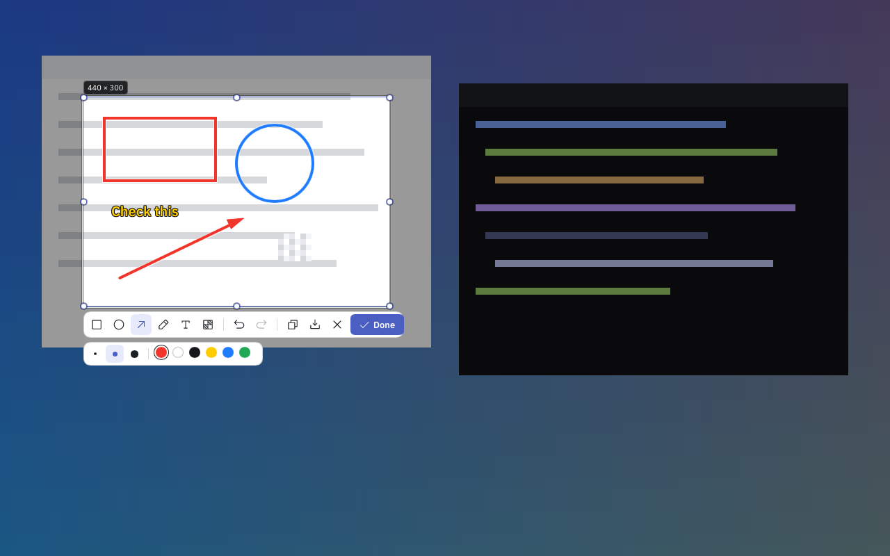
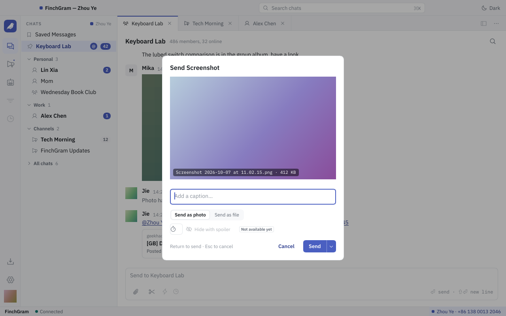
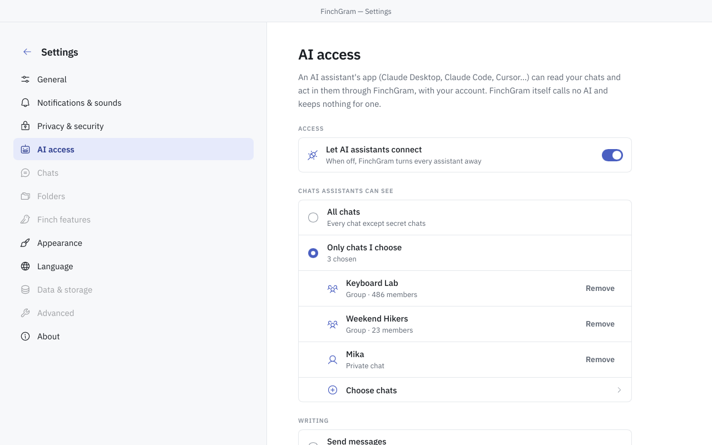
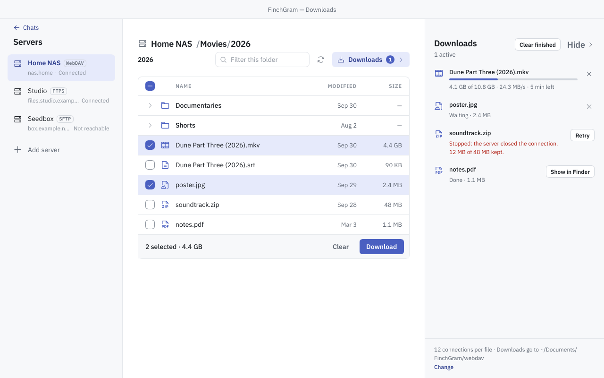

# FinchGram

[English](../README.md) · [简体中文](zh-Hans.md) · [繁體中文](zh-Hant.md) · [Español](es.md) · [Português](pt.md) · [Deutsch](de.md) · [Français](fr.md) · [Русский](ru.md) · [日本語](ja.md) · [한국어](ko.md) · **العربية**

<p align="center"></p>

**عميل Telegram لسطح المكتب بقدرات خارقة، مكتوب بـ Rust و[Slint](https://slint.dev).** مفتوح المصدر برخصة GPL-3.0.
اليوم لنظام macOS على Apple silicon؛ وWindows وLinux لاحقًا.

يتواصل FinchGram مع Telegram عبر [TDLib](https://core.telegram.org/tdlib)، مكتبة Telegram نفسها، ويلتزم
[بشروط واجهة Telegram البرمجية](https://core.telegram.org/api/terms). وهو عميل غير رسمي، ليس من صنع Telegram.

<p align="center"></p>

## ماذا يفعل

- **الدردشات.** تسجيل الدخول برقم الهاتف والرمز وكلمة مرور التحقق بخطوتين، أو بمسح رمز QR؛ أو إنشاء حساب جديد. قائمة
  الدردشات مع مجلدات Telegram والدردشات المثبتة وأعداد غير المقروء والإشارات؛ بحث في كل شيء (⌘K): دردشاتك وجهات اتصالك،
  والمستخدمين والمجموعات والقنوات العامة باسم المستخدم، والأشخاص برقم الهاتف، والرسائل؛ وبحث داخل الدردشة (⌘F)؛ وعرض
  لقنواتك وآخر لبوتاتك. والقلم يُنشئ مجموعة أو قناة أو دردشة جديدة، أو يضيف جهة اتصال.
  عدة حسابات، حتى عشرة، لكل منها TDLib خاص بها: التبديل من قائمة الحساب أو بـ ⌘1 … ⌘0.
  إدارة مجموعاتك وقنواتك: الصورة والاسم والوصف، اسم مستخدم عام أو روابط دعوة، الأعضاء والمشرفون وصلاحياتهم، صلاحيات الأعضاء، الوضع البطيء، الموافقة على الانضمام والمواضيع؛ تواقيع القناة ومجموعة النقاش.
- **الرسائل.** نص بتنسيقه (عريض، مائل، كود، روابط)، ردود وإعادة توجيه، صور وفيديوهات وصور GIF وملصقات وملفات، وبطاقة
  معاينة للروابط. النقر بزر الفأرة الأيمن على رسالة يفتح قائمتها: الرد والتعديل والنسخ ونسخ الرابط وإعادة التوجيه والإبلاغ
  والحذف، أو تحديد عدة رسائل. الصور والفيديوهات المرسلة للتدمير الذاتي تظهر مموّهة وتُفتح مرة واحدة، كما في تطبيقات
  Telegram نفسها. أزرار البوتات تحت رسائلها، ولوحات مفاتيحها وأوامرها وزر القائمة؛ والرسالة المثبتة تحت ترويسة الدردشة.
  الدردشة التي تحمي محتواها تُستبعد من لقطات الشاشة وتسجيلات الشاشة ما دامت في المقدمة. التفاعلات، مع لوحة اختيار ونقرة
  مزدوجة للتفاعل الافتراضي؛ ورسائل الفيديو الدائرية تُشغَّل في مكانها؛ وبطاقات جهات الاتصال مع «مراسلة» و«إضافة جهة
  اتصال» و«مشاركة»؛ ومشاركة منشور أو بطاقة إلى عدة دردشات في آن واحد؛ ومسودات تُحفظ لكل دردشة وعبر الأجهزة؛ والمجموعات
  ذات المواضيع تُفتح على مواضيعها؛ والوضع البطيء بعدّ تنازلي في حقل الكتابة، وقواعد المجموعة أو، للمشرفين، أذوناتها
  وخياراتها في لوحة إعدادات الدردشة.
- **الوسائط.** تُفتح الصور والفيديوهات في عارض فوق النافذة، مع بقية الألبوم؛ ويعمل الفيديو عبر mpv المبني من المصدر.
  الحفظ في «التنزيلات» حيث تسمح الدردشة بذلك.
- **التنزيلات.** عميل WebDAV في مركز الوسائط: جهاز NAS لديك، أو seedbox، أو PikPak، أو Alist/OpenList، أو مجلد مُشارَك
  عبر `vget serve`، تتصفّحها من داخل التطبيق. تصل الملفات عبر عدة اتصالات في آن واحد وتُستأنف بعد التوقف؛ وتُفتح الصور
  والفيديوهات في العارض عند وصولها؛ وتبقى كلمات المرور في قاعدة بيانات FinchGram المشفّرة. انظر [docs/downloads.md](../docs/downloads.md).
- **الإرسال.** الصور والفيديوهات والملفات من مشبك الورق، أو بسحبها إلى النافذة، أو بلصقها. بطاقة تعرضها قبل الإرسال: مع
  تعليق، كصورة أو كملف، معًا في ألبوم يصل إلى عشرة، مع مؤقّت تدمير ذاتي في دردشة خاصة، وبلا صوت.
- **لقطات الشاشة.** المقص في حقل الكتابة، أو ⌘⇧A، يجمّد الشاشة: خذ نافذة أو اسحب تحديدًا، وارسم عليه مستطيلات وأشكالًا
  بيضاوية وأسهمًا وخطوط قلم ونصًا وفسيفساء، ثم أرسله أو انسخه أو احفظه. كما في WeChat، من أي دردشة.
- **قائمة الدردشة.** كتم الصوت، التثبيت، نسخ المعرّف، الوضع في مجلد؛ حظر شخص أو إلغاء حظره، الإبلاغ،
  مغادرة مجموعة أو قناة، حذف دردشة. النقر بالزر الأيمن على مجلد يعلّم كل دردشاته كمقروءة، أو يرتّبها:
  حسب أحدث رسالة، أو الاسم، أو الرسائل غير المقروءة؛ وتبقى المثبّتة في الأعلى.
- **الإشعارات.** تصل الرسائل الجديدة كإشعارات macOS ويظهر عددها على أيقونة Dock؛ ويبقى FinchGram في Dock عند إغلاق
  نافذته، ويمكنه أن يسكن شريط القوائم.
- **ثلاث سمات.** Workbench وBroadsheet وTerminal، لكل منها فاتح وداكن، تُبدَّل دون إعادة تشغيل.
- **الإعدادات.** التشغيل عند تسجيل الدخول، الإرسال بـ Enter، اختصار لقطة الشاشة، أصوات الإشعارات ومعايناتها، التحقق
  بخطوتين، لغة الواجهة، والتحديثات: يحدّث التطبيق نفسه من GitHub Releases ولا يثبّت شيئًا لا يستطيع التحقق منه.
- **مساعدو الذكاء الاصطناعي.** يمكن لـ Claude Desktop وClaude Code وغيرها من التطبيقات التي تتحدث Model Context Protocol قراءة دردشاتك والتصرف فيها عبر FinchGram متى سمحت لها: الإعدادات → وصول الذكاء الاصطناعي، متوقف حتى تشغّله، مع الدردشات التي تختارها وما إذا كان يجوز للمساعد الإرسال، وسؤال عند اتصال التطبيق أول مرة. انظر [docs/mcp.md](../docs/mcp.md).
- **اللغات.** الواجهة وهذا الملف بإحدى عشرة لغة.

ليس بعد: الدردشات السرية، الرسائل الصوتية والمكالمات، الاستطلاعات والرسائل المجدولة، مرشّحات الكلمات
المفتاحية، Windows وLinux. انظر [ما يأتي لاحقًا](../docs/architecture.md#not-now).

## التنزيل

احصل على `FinchGram-<version>-macos-arm64.zip` من [أحدث إصدار](https://github.com/FinchGram/FinchGram/releases/latest)، وفكّ
ضغطه وانقل FinchGram إلى «التطبيقات». يحتاج إلى macOS 12 أو أحدث على Apple silicon. التطبيق موقّع بـ Developer ID
الخاص بشركة North Brookville LLC وموثّق من Apple، لذا يُفتح كأي تطبيق آخر. وبعدها يحدّث نفسه.

يأتي كل إصدار مع `SHA256SUMS` وتوقيعه Ed25519. يتحقق التطبيق منهما قبل تثبيت أي تحديث؛ ويمكنك أنت أيضًا، بالمفتاح
العام في [release-signing.pub](../release-signing.pub).

## ثلاث سمات

| Workbench | Broadsheet | Terminal |
|---|---|---|
|  |  |  |

Workbench، السمة الافتراضية، نافذة عمل بعلامات تبويب. وBroadsheet تُقرأ كصحيفة، بلون مميز لكل حساب. وTerminal شاشة
بخط ثابت العرض مع أوامر. لكل منها جانب فاتح وآخر داكن، تبعًا للنظام أو لاختيارك، في الإعدادات ← المظهر.

<p align="center"></p>

## أداة لقطة الشاشة

<p align="center"></p>

اضغط ⌘⇧A، أو المقص بجانب مشبك الورق. تتجمد الشاشة معتمةً تحت طبقة: تسحب تحديدًا، مع مكبّر والحجم بالبكسل، أو
تنقر نافذة لأخذها كاملة. يرسم شريط الأدوات مستطيلات وأشكالًا بيضاوية وأسهمًا وخطوط قلم ونصًا وفسيفساء، بثلاثة أحجام وستة ألوان،
مع التراجع. يضع Done الصورة في بطاقة الإرسال حيث يمكن إرفاق تعليق؛ وينسخها ⌘C؛ ويحفظها ⌘S في «التنزيلات». في
الإعدادات ← عام ← لقطات الشاشة يوجد الاختصار وما إذا كانت نافذة FinchGram تختفي في الأثناء.

<p align="center"></p>

## مساعدو الذكاء الاصطناعي

<p align="center"></p>

FinchGram خادم MCP: يمكن لتطبيق مساعد ذكاء اصطناعي على جهاز Mac لديك (Claude Desktop وClaude Code وCursor…) قراءة Telegram والتصرف فيه عبر التطبيق العامل بحسابك أنت. الإعدادات → وصول الذكاء الاصطناعي هو المفتاح، وهو متوقف افتراضيًا. هناك تختار الدردشات التي يراها المساعد (كلها ما عدا السرية، أو المختارة فقط) وما يمكنه كتابته (رسائل باسمك، أو مسودات فقط ترسلها أنت، أو لا شيء)، وترى أي التطبيقات اتصلت، بالأسماء التي يعطيها لها macOS، وما طلبته. عند اتصال تطبيق أول مرة يسألك FinchGram هل تسمح له. القراءة لا تجعل شيئًا مقروءًا، ولا تُعرض الدردشات السرية أبدًا، ولا يُحفظ شيء من أجل الذكاء الاصطناعي. تقدّم الصفحة السطر الذي تلصقه في Claude Code أو Claude Desktop؛ والتفاصيل في [docs/mcp.md](../docs/mcp.md).

## صفحة التنزيلات

<p align="center"></p>

عرض ← التنزيلات، أو أيقونة التنزيل فوق الترس. أضف خادم WebDAV (جهاز NAS، أو seedbox، أو PikPak، أو Alist/OpenList، أو
Nextcloud، أو `rclone serve webdav`، أو مجلدًا مُشارَكًا عبر `vget serve`)، وتصفّح مجلداته، وحدّد ملفات أو خذ مجلدًا كاملًا،
فتصل إلى ~/Documents/FinchGram/webdav: كل ملف في أجزاء من 8 ميغابايت عبر ما يصل إلى اثني عشر اتصالًا، ويُستأنف من حيث توقف بعد
«إعادة المحاولة»، كما تفعل أداة سطر الأوامر vget الخاصة بالمشرف. تعرض قائمة الانتظار على اليمين السرعة وما تبقّى؛ ويجلب
«فتح» صورة أو فيديو ويعرضه في العارض. يكتفي FinchGram بالقراءة من الخادم، وتذهب كلمة المرور إلى قاعدة بيانات FinchGram المشفّرة، لا إلى
ملف مكشوف أبدًا. في [docs/downloads.md](../docs/downloads.md) التفاصيل وما لم يُنجز بعد (تُرفض الشهادة الموقّعة ذاتيًا: استخدم
http على الشبكة المحلية، أو شهادة حقيقية).

## كيف بُني

التطبيق غلاف. أما Telegram نفسه فتتولاه TDLib، التي تعمل كبرنامج منفصل بجانب الملف التنفيذي، `finchgram-tdlib`، والذي
يبنيه هذا المستودع من مصادر مثبّتة؛ ولا يكلّمه الغلاف إلا عبر `src/telegram/`، بصيغة JSON الخاصة بـ TDLib. ويعمل الفيديو
عبر libmpv المبنية بالطريقة نفسها. لا يؤخذ شيء من جهاز المستخدم، ولا ينزّل البناء شيئًا سوى هذه البنيات المثبّتة ذات
مجاميع التحقق. كل شيء علني: المصدر، وبنيات `vendor/`، والإصدارات. انظر [docs/architecture.md](../docs/architecture.md)
و[docs/conventions.md](../docs/conventions.md).

## قواعد Telegram

يفعل FinchGram ما تفعله تطبيقات Telegram نفسها، ولا شيء مما تحظره. تُعلَّم الرسالة كمقروءة حين تراها، ويرى الطرف الآخر
أنك تكتب وأنك متصل كما في أي تطبيق Telegram، وتُعرض الرسائل المموّلة في القنوات، وتُفتح الوسائط ذاتية التدمير مرة
واحدة، ولا يذهب شيء من Telegram إلى أي ذكاء اصطناعي إلا إذا أدخلت مساعدًا بنفسك (الإعدادات → وصول الذكاء الاصطناعي). لا يغادر جهازك شيء إلا إلى Telegram، وإلى GitHub من أجل
التحديثات.

## التطوير

يتطلب التطوير حاليًا macOS على Apple silicon: إذ لا يُبنى finchgram-tdlib إلا له حتى الآن. سيأتي دعم Linux
وWindows لاحقًا.

لا يوجد finchgram-tdlib ولا libmpv ولا خطوط الواجهة في git: يحتوي `vendor/tdlib/` و`vendor/mpv/` فقط على
السكربتات التي تبنيهما، وتأتي الخطوط من Google Fonts. بعد استنساخ المستودع، احصل عليها مرة واحدة:

```sh
scripts/fetch-tdlib.sh    # ينزّل إصدار finchgram-tdlib المثبّت إلى vendor/tdlib/bin/ ويتحقق من SHA-256
scripts/fetch-mpv.sh      # ينزّل إصدار libmpv المثبّت إلى vendor/mpv/bin/ ويتحقق من SHA-256
scripts/fetch-fonts.sh    # ينزّل خطوط الواجهة المثبّتة إلى vendor/fonts/ ويتحقق من SHA-256
FINCHGRAM_API_ID=… FINCHGRAM_API_HASH=… cargo run
```

- لتعديل finchgram-tdlib نفسه، ابنِه هنا (بضع دقائق؛ يتطلب Xcode أو Command Line Tools،
  و`brew install cmake ninja gperf`، وهي أدوات بناء فقط):

  ```sh
  vendor/tdlib/build.sh && vendor/tdlib/build.sh install
  ```

- `FINCHGRAM_API_ID` و`FINCHGRAM_API_HASH`: الخاصان بك، من
  [my.telegram.org](https://my.telegram.org) ← API development tools. يُقرآن عند البناء ولا مكان لهما في
  المستودع أبدًا. من دونهما يعمل التطبيق ويذكر أنه لا يملك API ID.
- يستخدم `FINCHGRAM_TEST_DC=1 cargo run` خوادم الاختبار الخاصة بـ Telegram، ولها حساباتها الخاصة؛ ويحتفظ
  التطبيق لها بقاعدة بيانات منفصلة.
- يرسم `cargo test screenshots -- --ignored` كل صفحة في كل سمة، فاتحة وداكنة، مع دردشات متخيَّلة، في
  `target/screenshots/`: طريقة لرؤية الواجهة من دون حساب.

ينسخ `build.rs` الملف `vendor/tdlib/bin/finchgram-tdlib` بجوار الملف التنفيذي المُصرَّف، فيستخدم `cargo run`
البرنامج نفسه تمامًا الذي يستخدمه التطبيق المُحزَّم؛ ويربط libmpv من `vendor/mpv/bin/` وينسخها هناك أيضًا،
وتُضمَّن الخطوط الموجودة في `vendor/fonts/` داخل الملف التنفيذي. ومن دون أيٍّ منها يفشل البناء برسالة توضّح
ذلك. يتطلب Rust 1.92 أو أحدث.

قاعدة بيانات TDLib والملفات المنزّلة موجودة في `~/Library/Application Support/FinchGram/tdlib/`، والإعدادات
في `~/Library/Application Support/FinchGram/settings.toml`.

## البنية

```
.github/workflows/
  mpv.yml                # يبني libmpv على جهاز نظيف؛ وينشر وسوم mpv-* كإصدارات
  release.yml            # يبني التطبيق مع كل push إلى main؛ وينشر وسوم v* كإصدارات
  tdlib.yml              # يبني finchgram-tdlib على جهاز نظيف؛ وينشر وسوم tdlib-* كإصدارات
Cargo.toml
build.rs                 # يصرّف ui/app.slint، ويضمّن lang/، وينسخ vendor/tdlib/bin/ بجوار الملف التنفيذي
docs/                    # architecture.md و conventions.md و downloads.md و drag-and-drop.md و media-files.md و skia.md (+ zh-Hans)
  screenshots/           #   الصور التي تعرضها ملفات README، من اختبار اللقطات (scripts/readme-pictures.sh)
lang/                    # الترجمات: lang/<الرمز>/LC_MESSAGES/finchgram.po، مُضمَّنة في الملف الثنائي
readme/                  # ملف README هذا بلغات أخرى
release-signing.pub      # المفاتيح العامة المسموح لها بتوقيع الإصدارات؛ مُضمَّنة في التطبيق
scripts/
  bundle.sh              # يبني dist/FinchGram.app (وهو ما يشغّله مسار الإصدار)
  fetch-fonts.sh         # خطوط الواجهة المثبّتة إلى vendor/fonts/
  fetch-mpv.sh           # إصدار libmpv المثبّت إلى vendor/mpv/bin/
  fetch-tdlib.sh         # إصدار finchgram-tdlib المثبّت إلى vendor/tdlib/bin/
  readme-pictures.sh     # ينسخ صور ملفات README من target/screenshots/ إلى docs/screenshots/
  release.sh             # يبدأ إصدارًا: رقم الإصدار، والوسم، والدفع؛ ويتولى GitHub Actions الباقي
src/
  main.rs                # النافذة، والإعدادات، واللغة والسمة، والتحديثات؛ يشغّل Telegram
  fonts.rs               # خطوط الواجهة، مُضمَّنة في الملف التنفيذي
  images.rs              # صور الرسائل، تُفك خارج خيط الواجهة
  telegram/              # الشيفرة الوحيدة التي تتواصل مع finchgram-tdlib
    process.rs           #   يشغّل البرنامج: JSON الخاص بـ TDLib عبر الإدخال والإخراج القياسيين
    api.rs               #   أنواع TDLib التي يستخدمها FinchGram (td_api.tl للإصدار المثبّت)
    mod.rs               #   الطلبات والردود، وإعادة التشغيل؛ تذهب التحديثات إلى store
    store.rs             #   ما قاله TDLib عن الدردشات والمستخدمين والرسائل؛ نماذج الصفحات
    login.rs             #   تسجيل الدخول، وإنشاء الحساب
    chats.rs             #   قائمة الدردشات
    conversation.rs      #   الدردشة المفتوحة: الرسائل، والكتابة
    actions.rs           #   ما يمكن فعله برسالة: قائمتها، الرد، إعادة التوجيه…
    account.rs           #   الملف الشخصي، وتسجيل الخروج
    password.rs          #   التحقق بخطوتين في الإعدادات
    files.rs             #   تنزيل الملفات
    avatars.rs           #   صور الدردشات والأشخاص، بدل الحروف الأولى
    viewer.rs            #   عارض الوسائط: الصور والفيديو والحفظ في «التنزيلات»
    rich_text.rs         #   النص المنسّق: الغامق والمائل والروابط…
    notifications.rs     #   إشعارات الرسائل الجديدة، وعدد غير المقروءة على أيقونة Dock
    online.rs            #   يكون الحساب متصلًا ما دامت النافذة في المقدمة وقيد الاستخدام
  platform/              # ما يختلف من نظام تشغيل إلى آخر
  player/                # الفيديو عبر libmpv، يُرسم في النافذة عبر OpenGL
  screenshot/            # أداة لقطة الشاشة: الالتقاط، الطبقة، التعليقات، الصورة
  downloads/             # صفحة التنزيلات: عميل WebDAV بمحرّك متعدد الاتصالات
    webdav.rs            #   قوائم PROPFIND، والعناوين، ومصادقة Basic
    transfer.rs          #   ملف في أجزاء عبر عدة اتصالات، يُستأنف بعد التوقف
    mod.rs               #   حالة الصفحة، وخيوطها، وقائمة الانتظار، ونموذج الخوادم
  update.rs              # التحديث الذاتي: GitHub Releases، والتحقق من التوقيع، والاستبدال، وإعادة التشغيل
  settings.rs            # تفضيلات المستخدم (settings.toml)
  i18n.rs                # لغة الواجهة: الاختيار المحفوظ، وإلا لغة النظام، وإلا الإنجليزية
  screenshots.rs         # كل صفحة مرسومة في ملف PNG (cargo test screenshots -- --ignored)
  bin/                   # finchgram-release-sign.rs، أداة التوقيع Ed25519 للإصدارات
ui/
  app.slint              # النافذة الرئيسية: القوائم، وأي صفحة تظهر
  state.slint            # حالة التطبيق، يتشاركها Rust والصفحات
  telegram.slint         # ما يعرضه Telegram: الحساب، وتسجيل الدخول، والدردشات، والرسائل
  downloads.slint        # حالة صفحة التنزيلات: الخوادم، والمجلد، وقائمة الانتظار
  look.slint             # ألوان السمة وخطوطها وأشكالها، للصفحات المشتركة
  format.slint           # التواريخ والأعداد وأنواع الرسائل بلغة الواجهة
  widgets.slint          # أجزاء صغيرة مشتركة؛ chat.slint: ما تتشاركه نوافذ الدردشة
  viewer.slint           # عارض الوسائط فوق النافذة كلها، بأسلوب كل سمة
  pages/                 # الصفحات التي تتشاركها السمات الثلاث: تسجيل الدخول، والإعدادات، والملف الشخصي، والتنزيلات
  workbench/             # نافذة الدردشة في سمة Workbench (الافتراضية)
  broadsheet/            # نافذة الدردشة في سمة Broadsheet
  terminal/              # نافذة الدردشة في سمة Terminal
  icons/                 # أيقونات Phosphor (MIT)، عادية وثنائية اللون؛ يسردها icons.slint
  logo/                  # شعار FinchGram (svg وpng) وقواعد استخدامه
vendor/fonts/            # ليس في git: خطوط الواجهة (scripts/fetch-fonts.sh)
vendor/mpv/              # libmpv: ‏mpv وFFmpeg لتشغيل الفيديو
  build.sh               #   يبنيها من مصادر مثبّتة: الإصدارات وSHA-256 في أعلى الملف
  bin/                   #   ليست في git: المكتبة نفسها (scripts/fetch-mpv.sh أو build.sh install)
vendor/tdlib/            # finchgram-tdlib
  build.sh               #   يبنيه من مصادر مثبّتة: commit لـ TDLib، وإصدار OpenSSL وSHA-256 في أعلى الملف
  host/                  #   برنامجنا المضيف الصغير (main.cpp) وملف CMakeLists.txt الخاص به
  bin/                   #   ليس في git: البرنامج الذي يستخدمه التطبيق (scripts/fetch-tdlib.sh أو build.sh install)
  work/, dist/           #   ليسا في git: الملفات الوسيطة والحزمة الناتجة عن بناء محلي
```

## الترجمات

يُكتب كل نص في الواجهة بالشكل `@tr("English text")`. للسلسلة النصية ترجمة واحدة أينما ظهرت (يعطّل build.rs
السياق الافتراضي في Slint)؛ وعندما يحتاج النص الإنجليزي نفسه إلى كلمات مختلفة في موضع آخر، أعطه سياقًا:
`@tr("menu" => "Open")`. استخرج النصوص بالأداة الرسمية، ثم ادمجها في كل لغة:

```sh
cargo install slint-tr-extractor                                          # مرة واحدة
find ui -name '*.slint' | sort | xargs slint-tr-extractor --no-default-translation-context -o lang/finchgram.pot
for po in lang/*/LC_MESSAGES/finchgram.po; do msgmerge --update "$po" lang/finchgram.pot; done   # يتطلب brew install gettext
```

ثم املأ مدخلات `msgstr` وشغّل `cargo build` من جديد. الإنجليزية هي اللغة المصدر؛ واللغات العشر الأخرى مضمّنة.

## الإصدارات

لا يبني الإصدارات إلا GitHub Actions، من commit عليه وسم وعلى جهاز نظيف
(`.github/workflows/release.yml`)، وتُنشر في هذا المستودع: التطبيق مضغوطًا، و`SHA256SUMS`، وتوقيعه
بـ Ed25519. تُحدِّث النسخ المثبّتة نفسها من هنا، ولا تثبّت شيئًا لا تستطيع التحقق منه. يبدأ المشرف
الإصدار بأمر واحد:

```sh
scripts/release.sh patch    # 0.1.0 -> 0.1.1؛ وكذلك minor أو major أو إصدار محدد
```

التطبيق موقّع بـ Apple Developer ID الخاص بشركة North Brookville LLC مع تفعيل hardened runtime، وموثّق من
Apple: تُفتح النسخة المنزّلة دون سؤال من Gatekeeper، وكذلك التحديثات التي يثبّتها التطبيق بنفسه.

## المساهمة

المشكلات وطلبات السحب مرحّب بها. قبل تغيير طريقة تركيب الأجزاء، اقرأ [docs/architecture.md](../docs/architecture.md)
و[docs/conventions.md](../docs/conventions.md): كل اعتمادية يبنيها هذا المستودع من مصادر مثبّتة، والواجهة تتبع التصميم في
السمات الثلاث، ولا شيء في التطبيق يخالف شروط واجهة Telegram البرمجية. أبقِ `cargo test` و`cargo clippy --all-targets`
و`cargo test screenshots -- --ignored` نظيفة، وانظر إلى الصور. صور ملفات README تأتي من ذلك الاختبار أيضًا:
`scripts/readme-pictures.sh` يحدّث `docs/screenshots/`.

## الترخيص

GPL-3.0 ([LICENSE](../LICENSE)). يحتوي finchgram-tdlib على TDLib (Boost Software License 1.0) و
OpenSSL (Apache License 2.0)؛ وخطوط الواجهة مرخّصة بـ SIL Open Font License 1.1، والأيقونات بترخيص MIT.
وترافق نصوص تراخيصها التطبيق.
