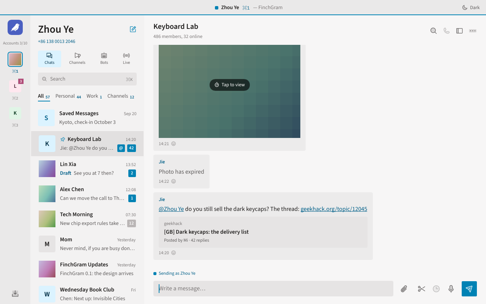
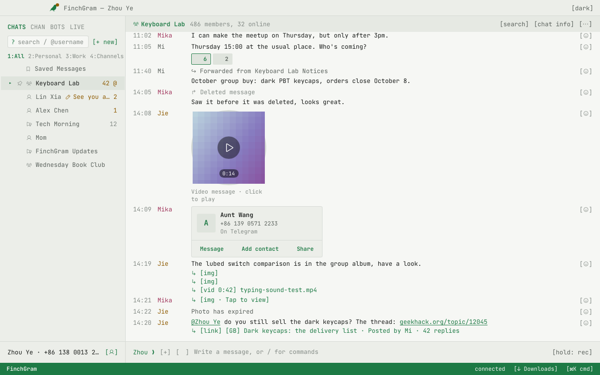

# FinchGram

[English](../README.md) · [简体中文](zh-Hans.md) · [繁體中文](zh-Hant.md) · **Español** · [Português](pt.md) · [Deutsch](de.md) · [Français](fr.md) · [Русский](ru.md) · [日本語](ja.md) · [한국어](ko.md) · [العربية](ar.md)

**Un cliente de escritorio de Telegram con superpoderes, en Rust y [Slint](https://slint.dev).**
Código abierto bajo la GPL-3.0. Hoy para macOS en Apple silicon; Windows y Linux, más adelante.

FinchGram habla con Telegram a través de [TDLib](https://core.telegram.org/tdlib), la biblioteca del
propio Telegram, y respeta los [términos de la API de Telegram](https://core.telegram.org/api/terms).
Es un cliente no oficial, no hecho por Telegram.

## Qué hace

- **Telegram, como en sus propias apps.** Chats con carpetas, búsqueda y hasta diez cuentas; mensajes con respuestas, reacciones, bots, temas y borradores; fotos, vídeos, archivos y mensajes de voz; la gestión de tus grupos y canales.
- **Una herramienta de capturas.** ⌘⇧A congela la pantalla: toma una ventana o una selección, dibuja encima y envíala. Desde cualquier chat, como en WeChat.
- **Descargas.** Un cliente de descargas para tus propios servidores por WebDAV, FTP, FTPS o SFTP: un NAS, una seedbox, PikPak. [Más](../docs/downloads.md)
- **Música.** Un reproductor para tus propios servidores que hablan la API de Subsonic: Navidrome y similares. [Más](../docs/music.md)
- **Directos.** Owncast, PeerTube, Icecast y los del propio Telegram: descúbrelos, síguelos y míralos en la app. [Más](../docs/live-streams.md)
- **Dictado por voz.** Habla y las palabras van al cuadro de texto, a través del proveedor de IA que elijas y con tu propia clave. [Más](../docs/voice-input.md)
- **Asistentes de IA.** Claude y otras apps con MCP leen tus chats y actúan en ellos a través de FinchGram, cuando tú lo permites. [Más](../docs/mcp.md)
- **Tres temas.** Workbench, Broadsheet y Terminal, cada uno claro y oscuro. Terminal tiene una línea de comandos de verdad. [Cómo usarla](../docs/terminal.md)
- **Once idiomas**, y actualizaciones que la app instala sola, después de verificarlas.

[Todo lo que hace, con imágenes](../docs/features.md). Todavía no: chats secretos y llamadas, encuestas y mensajes programados, filtros por palabras clave, Windows y Linux. Mira [qué viene después](../docs/architecture.md#not-now).

## Descarga

Descarga `FinchGram-<versión>-macos-arm64.zip` de la [última versión](https://github.com/FinchGram/FinchGram/releases/latest),
descomprímelo y mueve FinchGram a Aplicaciones. Necesita macOS 12 o posterior en Apple silicon. La app
está firmada con el Developer ID de North Brookville LLC y notarizada por Apple, así que se abre
como cualquier otra. A partir de ahí se actualiza sola.

Cada versión viene con `SHA256SUMS` y su firma Ed25519. La app comprueba ambas antes de instalar una
actualización; tú también puedes, con la clave pública de [release-signing.pub](../release-signing.pub).

## Tres temas

| Workbench | Broadsheet | Terminal |
|---|---|---|
|  |  |  |

Workbench, el tema por defecto, es una ventana de trabajo con pestañas. Broadsheet se lee como un
periódico, con un color de acento por cuenta. Terminal es una pantalla monoespaciada con comandos.
Cada uno tiene un lado claro y otro oscuro, según el sistema o tu elección, en Ajustes → Apariencia.

Terminal ejecuta comandos desde la línea de abajo: pulsa ⌘K o escribe `/`. [El tema Terminal](../docs/terminal.md) tiene los comandos y las teclas.

## Las reglas de Telegram

FinchGram hace lo que hacen las apps de Telegram y nada de lo que prohíben. Un mensaje se marca como
leído cuando lo ves, la otra parte te ve escribiendo y en línea como en cualquier app de Telegram,
los mensajes patrocinados de los canales se muestran, los archivos que se autodestruyen se abren una
vez y nada de Telegram va a ninguna IA, salvo que dejes entrar a un asistente (Herramientas → Acceso
de IA) o actives la transcripción de mensajes de voz con tu propio proveedor de IA. Nada sale de tu máquina
salvo hacia Telegram, hacia GitHub para las actualizaciones y, mientras usas el dictado por voz, tu
voz hacia el proveedor de IA que elegiste, con tu propia clave.

## Documentación

Los documentos están en inglés y en chino.

- [Qué hace FinchGram](../docs/features.md): cada función, con imágenes.
- [El tema Terminal](../docs/terminal.md): su línea de comandos y sus comandos.
- [Compilar desde el código fuente](../docs/development.md), [la estructura del repositorio](../docs/layout.md), [las traducciones](../docs/translations.md) y [las versiones](../docs/releases.md).
- [Arquitectura](../docs/architecture.md) y [convenciones](../docs/conventions.md): cómo está hecho, y por qué.

## Desarrollo

La app es una carcasa: de Telegram se ocupa TDLib, que corre como un programa aparte junto a ella y que este repositorio compila desde fuentes fijadas, igual que libmpv y Skia. Para compilar hace falta macOS en Apple silicon y un API ID de Telegram propio; los pasos están en [docs/development.md](../docs/development.md).

## Contribuir

Los issues y los pull requests son bienvenidos. Antes de cambiar cómo encajan las piezas, lee
[docs/architecture.md](../docs/architecture.md) y [docs/conventions.md](../docs/conventions.md): cada
dependencia la compila este repositorio desde fuentes fijadas, la interfaz sigue el diseño en los tres
temas y nada en la app va contra los términos de la API de Telegram. Mantén limpios `cargo test`,
`cargo clippy --all-targets` y `cargo test screenshots -- --ignored`, y mira las imágenes. Las
imágenes de los README también salen de esa prueba: `scripts/readme-pictures.sh` actualiza
`docs/screenshots/`.

## Licencia

GPL-3.0 ([LICENSE](../LICENSE)). finchgram-tdlib contiene TDLib (Boost Software License 1.0) y
OpenSSL (Apache License 2.0); las fuentes de la interfaz están bajo la SIL Open Font License 1.1 y los
iconos bajo la licencia MIT. Sus textos de licencia se distribuyen con la app.
