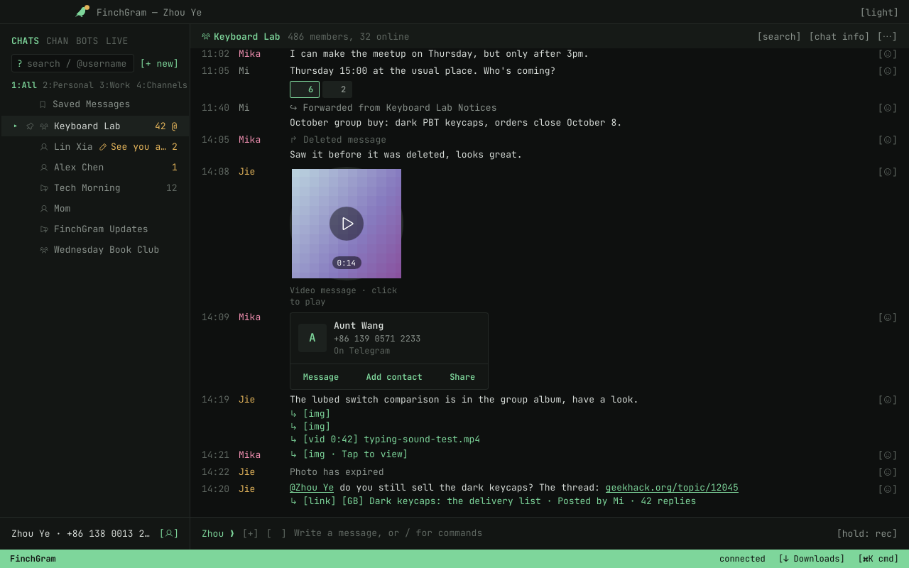
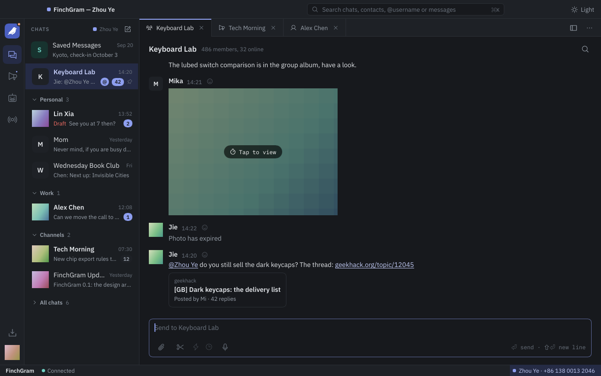

# FinchGram

[English](../README.md) · [简体中文](zh-Hans.md) · [繁體中文](zh-Hant.md) · [Español](es.md) · [Português](pt.md) · [Deutsch](de.md) · **Français** · [Русский](ru.md) · [日本語](ja.md) · [한국어](ko.md) · [العربية](ar.md)

**Un client Telegram de bureau avec des superpouvoirs, en Rust et [Slint](https://slint.dev).**
Libre, sous GPL-3.0. Aujourd'hui pour macOS sur Apple silicon ; Windows et Linux plus tard.

FinchGram parle à Telegram par [TDLib](https://core.telegram.org/tdlib), la bibliothèque de Telegram
lui-même, et respecte les [conditions de l'API Telegram](https://core.telegram.org/api/terms). C'est
un client non officiel, qui n'est pas fait par Telegram.

## Ce qu'il fait

- **Telegram, comme dans ses propres apps.** Des discussions avec dossiers, recherche et jusqu'à dix comptes ; des messages avec réponses, réactions, bots, sujets et brouillons ; photos, vidéos, fichiers et messages vocaux ; la gestion de vos groupes et chaînes.
- **Un outil de capture.** ⌘⇧A fige l'écran : prenez une fenêtre ou une sélection, dessinez dessus, envoyez. Depuis chaque discussion, comme dans WeChat.
- **Téléchargements.** Un client de téléchargement pour vos propres serveurs en WebDAV, FTP, FTPS ou SFTP : un NAS, une seedbox, PikPak. [En savoir plus](../docs/downloads.md)
- **Musique.** Un lecteur pour vos propres serveurs qui parlent l'API Subsonic : Navidrome et ses semblables. [En savoir plus](../docs/music.md)
- **Directs.** Owncast, PeerTube, Icecast et ceux de Telegram : à découvrir, à suivre et à regarder dans l'app. [En savoir plus](../docs/live-streams.md)
- **Saisie vocale.** Parlez, et les mots vont dans la zone de saisie, par le fournisseur d'IA que vous choisissez et avec votre propre clé. [En savoir plus](../docs/voice-input.md)
- **Assistants IA.** Claude et d'autres apps MCP lisent vos discussions et y agissent à travers FinchGram, une fois que vous l'autorisez. [En savoir plus](../docs/mcp.md)
- **Trois thèmes.** Workbench, Broadsheet et Terminal, chacun clair et sombre. Terminal a une vraie ligne de commande. [Comment s'en servir](../docs/terminal.md)
- **Onze langues**, et des mises à jour que l'app installe elle-même, après les avoir vérifiées.

[Tout ce qu'il fait, en images](../docs/features.md). Pas encore : discussions secrètes et appels, sondages et messages programmés, filtres par mots-clés, Windows et Linux. Voir [ce qui vient ensuite](../docs/architecture.md#not-now).

## Téléchargement

Prenez `FinchGram-<version>-macos-arm64.zip` dans la [dernière version](https://github.com/FinchGram/FinchGram/releases/latest),
décompressez-le et déplacez FinchGram dans Applications. Il faut macOS 12 ou plus récent sur Apple
silicon. L'application est signée avec le Developer ID de North Brookville LLC et notariée par Apple, elle
s'ouvre donc comme n'importe quelle autre. Ensuite elle se met à jour
elle-même.

Chaque version vient avec `SHA256SUMS` et sa signature Ed25519. L'application vérifie les deux avant
d'installer une mise à jour ; vous le pouvez aussi, avec la clé publique de
[release-signing.pub](../release-signing.pub).

## Trois thèmes

| Workbench | Broadsheet | Terminal |
|---|---|---|
|  |  |  |

Workbench, le thème par défaut, est une fenêtre de travail à onglets. Broadsheet se lit comme un
journal, avec une couleur d'accent par compte. Terminal est un écran en chasse fixe avec des
commandes. Chacun a un côté clair et un côté sombre, selon le système ou votre choix, dans Réglages →
Apparence.

Terminal exécute des commandes depuis la ligne du bas : appuyez sur ⌘K, ou tapez `/`. [Le thème Terminal](../docs/terminal.md) donne les commandes et les touches.

## Les règles de Telegram

FinchGram fait ce que font les applications de Telegram, et rien de ce qu'elles interdisent. Un
message est marqué lu quand vous le voyez, l'autre côté vous voit écrire et en ligne comme dans
toute application Telegram, les messages sponsorisés des chaînes sont affichés, les médias qui
s'autodétruisent s'ouvrent une fois, et rien de Telegram ne va à une IA, sauf si vous laissez entrer
un assistant (Boîte à outils → Accès IA) ou activez la transcription des messages vocaux par votre
propre fournisseur d'IA. Rien ne quitte votre machine sauf vers Telegram, vers GitHub pour les mises à jour et,
pendant que vous utilisez la saisie vocale, votre voix vers le fournisseur d'IA que vous avez
choisi, avec votre propre clé.

## Documentation

Les documents sont en anglais et en chinois.

- [Ce que fait FinchGram](../docs/features.md) : chaque fonction, en images.
- [Le thème Terminal](../docs/terminal.md) : sa ligne de commande et ses commandes.
- [Compiler depuis les sources](../docs/development.md), [l'organisation du dépôt](../docs/layout.md), [les traductions](../docs/translations.md) et [les versions publiées](../docs/releases.md).
- [Architecture](../docs/architecture.md) et [conventions](../docs/conventions.md) : comment c'est fait, et pourquoi.

## Développement

L'app est une coque : Telegram lui-même est l'affaire de TDLib, qui tourne comme un programme à part à côté d'elle et que ce dépôt compile depuis des sources figées, comme libmpv et Skia. Compiler demande macOS sur Apple silicon et un API ID Telegram à vous ; les étapes sont dans [docs/development.md](../docs/development.md).

## Contribuer

Les issues et les pull requests sont les bienvenus. Avant de changer la façon dont les pièces
s'assemblent, lisez [docs/architecture.md](../docs/architecture.md) et
[docs/conventions.md](../docs/conventions.md) : chaque dépendance est compilée par ce dépôt depuis des
sources figées, l'interface suit le design dans les trois thèmes, et rien dans l'application ne va
contre les conditions de l'API Telegram. Gardez `cargo test`, `cargo clippy --all-targets` et
`cargo test screenshots -- --ignored` propres, et regardez les images. Les images des README viennent
aussi de ce test : `scripts/readme-pictures.sh` rafraîchit `docs/screenshots/`.

## Licence

GPL-3.0 ([LICENSE](../LICENSE)). finchgram-tdlib contient TDLib (Boost Software License 1.0) et
OpenSSL (Apache License 2.0) ; les polices de l'interface sont sous SIL Open Font License 1.1, les icônes
sous licence MIT. Leurs textes de licence accompagnent l'application.
