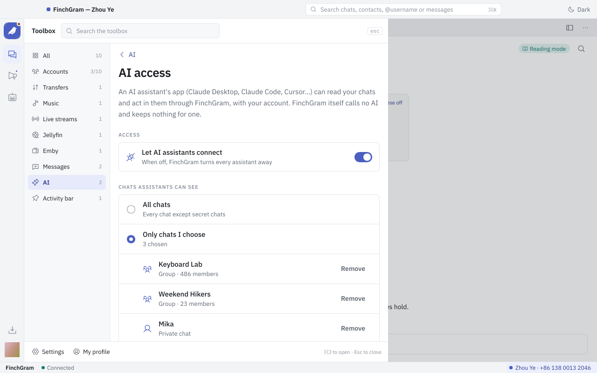

# FinchGram

[English](../README.md) · [简体中文](zh-Hans.md) · [繁體中文](zh-Hant.md) · [Español](es.md) · **Português** · [Deutsch](de.md) · [Français](fr.md) · [Русский](ru.md) · [日本語](ja.md) · [한국어](ko.md) · [العربية](ar.md)

<p align="center"></p>

**Um cliente de desktop do Telegram com superpoderes, em Rust e [Slint](https://slint.dev).**
Código aberto sob a GPL-3.0. Hoje para macOS em Apple silicon; Windows e Linux depois.

O FinchGram fala com o Telegram pela [TDLib](https://core.telegram.org/tdlib), a biblioteca do
próprio Telegram, e respeita os [termos da API do Telegram](https://core.telegram.org/api/terms).
É um cliente não oficial, não feito pelo Telegram.

<p align="center"></p>

## O que ele faz

- **Chats.** Entre com o número de telefone, o código e a senha da verificação em duas etapas, ou
  lendo um código QR; ou crie uma conta nova. A lista de chats com as pastas do Telegram, os chats
  fixados, as contagens de não lidos e as menções; uma busca em tudo (⌘K): seus chats e contatos,
  usuários, grupos e canais públicos pelo nome de usuário, pessoas pelo número de telefone e
  mensagens; uma busca dentro do chat (⌘F); uma visão dos seus canais e outra dos seus bots.
  O lápis cria um novo grupo, canal ou chat, ou adiciona um contato.
  Várias contas, até dez, cada uma com o seu próprio TDLib: troque pelo menu da conta ou com ⌘1 … ⌘0.
  Gerencie seus grupos e canais: foto, nome e descrição, nome de usuário público ou links de convite, membros e administradores com seus direitos, permissões dos membros, modo lento, aprovação de entrada e tópicos; assinaturas e grupo de discussão de um canal.
- **Mensagens.** Texto com formatação (negrito, itálico, código, links), respostas e encaminhamentos,
  fotos, vídeos, GIFs, figurinhas, arquivos e um cartão com a prévia de um link. Um clique direito
  numa mensagem abre o menu dela: responder, editar, copiar, copiar o link, encaminhar, denunciar,
  apagar ou selecionar várias. Fotos e vídeos enviados para se autodestruir aparecem desfocados e
  abrem uma única vez, como nos apps do Telegram. Os botões dos bots sob as mensagens deles, os
  teclados, os comandos e o botão de menu; a mensagem fixada do chat sob o cabeçalho. Um chat com
  conteúdo protegido fica de fora das capturas e gravações de tela enquanto está em primeiro plano.
  Reações, com um seletor e um clique duplo para a reação padrão; mensagens de vídeo redondas
  reproduzidas ali mesmo; cartões de contato com Mensagem, Adicionar contato e Compartilhar;
  compartilhamento de uma publicação ou de um cartão com vários chats de uma vez; rascunhos
  guardados por chat e em todos os dispositivos; grupos com tópicos, que abrem na lista de tópicos;
  modo lento com contagem regressiva na caixa de escrita e, no painel de configurações do chat, as
  regras do grupo ou, para os administradores, as permissões e opções.
- **Mídia.** Fotos e vídeos abrem num visualizador sobre a janela, com o resto do álbum; o vídeo toca
  com o mpv, compilado do código-fonte. Salvar em Downloads onde o chat permite.
- **Downloads.** Um cliente de downloads na central de mídia, por WebDAV, FTP, FTPS ou SFTP: o seu
  NAS, um seedbox, o PikPak, o Alist/OpenList ou uma pasta compartilhada com o `vget serve`, navegados no app. Os arquivos vêm
  por várias conexões ao mesmo tempo e continuam de onde pararam; fotos e vídeos abrem no
  visualizador quando chegam; as senhas ficam seladas no banco de dados do FinchGram. Veja
  [docs/downloads.md](../docs/downloads.md).
- **Envio.** Fotos, vídeos e arquivos pelo clipe, arrastando-os para a janela ou colando-os. Um cartão
  os mostra antes de ir: com legenda, como foto ou como arquivo, juntos num álbum de até dez, com
  timer de autodestruição num chat privado, sem som.
- **Capturas de tela.** A tesoura na caixa de escrita, ou ⌘⇧A, congela a tela: pegue uma janela ou
  arraste uma seleção, desenhe retângulos, elipses, setas, traços, texto e mosaico por cima, e
  envie, copie ou salve. Como no WeChat, a partir de qualquer chat.
- **O menu de um chat.** Silenciar, fixar, copiar o seu ID, colocar numa pasta; bloquear ou
  desbloquear uma pessoa, denunciar, sair de um grupo ou canal, apagar um chat. Um clique direito
  numa pasta marca todos os seus chats como lidos, ou ordena-os: pela última mensagem, por nome ou
  por mensagens não lidas; os fixados ficam no topo.
- **Notificações.** Mensagens novas chegam como notificações do macOS e o número delas fica no ícone
  do Dock; o FinchGram continua no Dock quando a janela fecha e pode morar na barra de menus.
- **Três temas.** Workbench, Broadsheet e Terminal, cada um claro e escuro, trocados sem reiniciar.
- **Configurações.** Abrir ao iniciar a sessão, enviar com Enter, o atalho da captura, sons e prévias
  das notificações, verificação em duas etapas, o idioma da interface e as atualizações: o app se
  atualiza sozinho a partir do GitHub Releases e não instala nada que não consiga verificar.
- **Mensagens de voz.** Tocam na conversa, com a forma de onda, o tempo e 1×, 1,5× ou 2×;
  ouvir avisa o remetente, como nos apps do Telegram. Segure o microfone para gravar uma: solte
  para enviar, arraste para a esquerda para cancelar ou para cima para travar, e pare para ouvir
  antes de enviar.
- **Ditado por voz.** Clique em ✦ na caixa de texto e fale: o texto vai para a caixa, sem os éé e
  hum, para você enviar. Você escolhe os serviços pelo formato da API deles, com as suas próprias
  chaves e, se quiser, o seu próprio endereço (um intermediário ou um servidor da sua rede): a
  transcrição em tempo real da OpenAI, Qwen e Doubao (os dois fortes em chinês) ou qualquer serviço
  que fale a API de transcrição da OpenAI; o ajuste do texto, no formato da OpenAI, da Anthropic ou
  do Gemini. Cada idioma principal tem a sua própria configuração, e as palavras de outros idiomas
  misturadas ficam como você disse. Ferramentas → AI → Ditado por voz, desligado até você ligar.
  “Transcrever” sob uma mensagem de voz usa a transcrição do próprio Telegram, ou o seu serviço se
  você ligar isso. Veja [docs/voice-input.md](../docs/voice-input.md).
- **Assistentes de IA.** Claude Desktop, Claude Code e outros apps que falam o Model Context
  Protocol podem ler suas conversas e agir nelas pelo FinchGram, quando você permite: Ferramentas → Acesso de IA, desligado até você ligar, com as conversas que escolher e se um assistente pode
  enviar ou não, e uma pergunta na primeira vez que um app se conecta. Veja
  [docs/mcp.md](../docs/mcp.md).
- **Idiomas.** A interface e este README em onze idiomas.

Ainda não: chats secretos e chamadas, enquetes e mensagens agendadas, filtros por
palavra-chave, Windows e Linux. Veja
[o que vem a seguir](../docs/architecture.md#not-now).

## Download

Baixe `FinchGram-<versão>-macos-arm64.zip` da [última versão](https://github.com/FinchGram/FinchGram/releases/latest),
descompacte e mova o FinchGram para Aplicativos. Precisa de macOS 12 ou mais novo em Apple silicon.
O app é assinado com o Developer ID da North Brookville LLC e notarizado pela Apple, então abre
como qualquer outro. Daí em diante ele se atualiza sozinho.

Cada versão vem com `SHA256SUMS` e sua assinatura Ed25519. O app confere as duas antes de instalar uma
atualização; você também pode, com a chave pública em [release-signing.pub](../release-signing.pub).

## Três temas

| Workbench | Broadsheet | Terminal |
|---|---|---|
|  |  |  |

O Workbench, o padrão, é uma janela de trabalho com abas. O Broadsheet se lê como um jornal, com uma
cor de destaque por conta. O Terminal é uma tela monoespaçada com comandos. Cada um tem um lado claro
e um escuro, seguindo o sistema ou a sua escolha, em Configurações → Aparência.

<p align="center"></p>

## A ferramenta de captura

<p align="center"></p>

Pressione ⌘⇧A, ou a tesoura ao lado do clipe. A tela congela, escurecida, sob uma camada: você arrasta
uma seleção, com uma lupa e o tamanho em pixels, ou clica numa janela para tomá-la inteira. A barra de
ferramentas desenha retângulos, elipses, setas, traços, texto e mosaico, em três tamanhos e seis
cores, com desfazer. Done põe a imagem no cartão de envio, onde pode levar uma legenda; ⌘C a copia; ⌘S
a salva em Downloads. Configurações → Geral → Capturas de tela guarda o atalho e se a janela do
FinchGram se esconde enquanto isso.

<p align="center"></p>

## Assistentes de IA

<p align="center"></p>

O FinchGram é um servidor MCP: o app de um assistente de IA no seu Mac (Claude Desktop, Claude Code,
Cursor…) pode ler seu Telegram e agir nele pelo app em execução, com a sua própria conta.
Ferramentas → Acesso de IA é o interruptor, desligado por padrão. Ali você escolhe quais conversas
um assistente pode ver (todas menos as secretas, ou só as escolhidas) e o que ele pode escrever
(mensagens em seu nome, só rascunhos que você envia, ou nada), e vê quais apps se conectaram, com o
nome que o macOS dá a eles, e o que pediram. Na primeira vez que um app se conecta, o FinchGram
pergunta se deve permitir. Ler não marca nada como lido, conversas secretas nunca são mostradas e
nada é guardado para uma IA. A página dá a linha para colar no Claude Code ou no Claude Desktop; os
detalhes estão em [docs/mcp.md](../docs/mcp.md).

## A página de downloads

<p align="center"></p>

Visualizar → Downloads, ou o ícone de download acima da engrenagem. Adicione um servidor por WebDAV, FTP,
FTPS ou SFTP (um NAS, um seedbox, o PikPak, o Alist/OpenList, o Nextcloud, o `rclone serve webdav` ou uma pasta
compartilhada com o `vget serve`), navegue pelas pastas dele, marque arquivos ou pegue uma pasta
inteira, e eles chegam em ~/Documents/FinchGram/webdav: cada arquivo em pedaços de 8 MB por até doze
conexões, continuando de onde parou depois de um Tentar novamente, como faz o vget, a ferramenta de
linha de comando do mantenedor. A fila à direita mostra a velocidade e o que falta; Abrir busca uma
foto ou um vídeo e o mostra no visualizador. O FinchGram não altera nada em um servidor a menos que você permita para aquele servidor (então ele pode apagar, mover, renomear e enviar lá), e a senha vai selada para o banco de
dados do FinchGram, nunca para um arquivo em texto claro. [docs/downloads.md](../docs/downloads.md) tem os detalhes e
o que ainda falta (um certificado autoassinado é recusado: use http na rede local, ou um
certificado de verdade).

## Como é feito

O app é uma casca. O Telegram em si fica com a TDLib, que roda como um programa separado ao lado do
executável, o `finchgram-tdlib`, que este repositório compila de fontes fixadas; a casca só fala com
ele por `src/telegram/`, no JSON da própria TDLib. O vídeo toca com a libmpv, compilada do mesmo jeito.
Nada é tirado da máquina do usuário, e uma compilação não baixa nada além dessas compilações fixadas e
com soma de verificação. Tudo é público: o código, as compilações em `vendor/` e as versões. Veja
[docs/architecture.md](../docs/architecture.md) e [docs/conventions.md](../docs/conventions.md).

## As regras do Telegram

O FinchGram faz o que os apps do Telegram fazem e nada do que eles proíbem. Uma mensagem é marcada
como lida quando você a vê, o outro lado vê você digitando e online como em qualquer app do
Telegram, as mensagens patrocinadas dos canais aparecem, a mídia que se autodestrói abre uma vez e
nada do Telegram vai para nenhuma IA, a menos que você deixe um assistente entrar (Ferramentas →
Acesso de IA) ou ligue a transcrição de mensagens de voz com o seu próprio serviço. Nada sai da sua
máquina a não ser para o Telegram, para o GitHub para as atualizações e, enquanto você usa o ditado
por voz, a sua voz para o serviço de reconhecimento que você escolheu, com a sua própria chave.

## Desenvolvimento

Por enquanto, o desenvolvimento requer macOS com Apple silicon: o finchgram-tdlib só é compilado para
essa plataforma. Linux e Windows virão depois.

Nem o finchgram-tdlib, nem a libmpv, nem as fontes da interface ficam no git: `vendor/tdlib/` e
`vendor/mpv/` guardam só os scripts que os compilam, e as fontes vêm do Google Fonts. Depois de clonar,
baixe-os uma vez:

```sh
scripts/fetch-tdlib.sh    # baixa a release fixada do finchgram-tdlib para vendor/tdlib/bin/ e verifica o SHA-256
scripts/fetch-mpv.sh      # baixa a release fixada da libmpv para vendor/mpv/bin/ e verifica o SHA-256
scripts/fetch-fonts.sh    # baixa as fontes fixadas da interface para vendor/fonts/ e verifica o SHA-256
FINCHGRAM_API_ID=… FINCHGRAM_API_HASH=… cargo run
```

- Para mudar o próprio finchgram-tdlib, compile-o aqui (alguns minutos; precisa do Xcode ou das
  Command Line Tools, e de `brew install cmake ninja gperf`, só ferramentas de compilação):

  ```sh
  vendor/tdlib/build.sh && vendor/tdlib/build.sh install
  ```

- `FINCHGRAM_API_ID` e `FINCHGRAM_API_HASH`: os seus, de
  [my.telegram.org](https://my.telegram.org) → API development tools. Eles são lidos na compilação e
  nunca devem ir para o repositório. Sem eles, o app abre e avisa que não tem API ID.
- `FINCHGRAM_TEST_DC=1 cargo run` usa os servidores de teste do Telegram, que têm contas próprias; o app
  mantém um banco de dados separado para eles.
- `cargo test screenshots -- --ignored` desenha cada página de cada tema, claro e escuro, com conversas
  inventadas, em `target/screenshots/`: um jeito de ver a interface sem uma conta.

`build.rs` copia `vendor/tdlib/bin/finchgram-tdlib` para junto do executável compilado, então
`cargo run` usa exatamente o mesmo programa que o app empacotado; ele liga a libmpv de
`vendor/mpv/bin/` e também a copia para lá, e as fontes de `vendor/fonts/` são compiladas dentro do
executável. Sem qualquer um deles, a compilação falha com uma mensagem explicando isso. Rust 1.92 ou mais
recente.

O banco de dados do TDLib e os arquivos baixados ficam em
`~/Library/Application Support/FinchGram/tdlib/`; as configurações, em
`~/Library/Application Support/FinchGram/settings.toml`.

## Estrutura

```
.github/workflows/
  mpv.yml                # compila a libmpv numa máquina limpa; publica as tags mpv-* como releases
  check.yml              # clippy e os testes a cada push na main
  release.yml            # compila e publica o app para os commits Release v*
  tdlib.yml              # compila o finchgram-tdlib numa máquina limpa; publica as tags tdlib-* como releases
Cargo.toml
build.rs                 # compila ui/app.slint, empacota lang/, copia vendor/tdlib/bin/ para junto do executável
docs/                    # architecture.md, conventions.md, downloads.md, drag-and-drop.md, media-files.md, skia.md (+ zh-Hans)
  screenshots/           #   as imagens que os READMEs mostram, do teste de capturas (scripts/readme-pictures.sh)
lang/                    # traduções: lang/<código>/LC_MESSAGES/finchgram.po, compiladas no binário
readme/                  # este README em outros idiomas
release-signing.pub      # as chaves públicas que podem assinar as releases; compiladas no app
scripts/
  bundle.sh              # monta dist/FinchGram.app (o que o fluxo de release executa)
  fetch-fonts.sh         # as fontes fixadas da interface para vendor/fonts/
  fetch-mpv.sh           # a release fixada da libmpv em vendor/mpv/bin/
  fetch-tdlib.sh         # a release fixada do finchgram-tdlib em vendor/tdlib/bin/
  readme-pictures.sh     # copia as imagens dos READMEs de target/screenshots/ para docs/screenshots/
  release.sh             # inicia uma release: versão, tag, push; o GitHub Actions faz o resto
src/
  main.rs                # a janela, as configurações, o idioma e o tema, as atualizações; inicia o Telegram
  fonts.rs               # as fontes da interface, compiladas dentro do executável
  images.rs              # as imagens das mensagens, decodificadas fora da thread da interface
  telegram/              # o único código que fala com o finchgram-tdlib
    process.rs           #   executa o programa: o JSON do TDLib pela entrada e saída padrão
    api.rs               #   os tipos do TDLib que o FinchGram usa (td_api.tl da versão fixada)
    mod.rs               #   pedidos e respostas, reiniciar; as atualizações vão para o store
    store.rs             #   o que o TDLib disse sobre conversas, usuários e mensagens; os modelos das páginas
    login.rs             #   o login, o cadastro
    chats.rs             #   a lista de conversas
    conversation.rs      #   a conversa aberta: mensagens, escrever
    actions.rs           #   o que se pode fazer com uma mensagem: o menu, responder, encaminhar…
    account.rs           #   o perfil, sair
    password.rs          #   a verificação em duas etapas nas Configurações
    files.rs             #   o download de arquivos
    avatars.rs           #   as fotos de chats e pessoas, no lugar das iniciais
    viewer.rs            #   o visualizador: fotos, vídeos, salvar em Downloads
    rich_text.rs         #   texto formatado: negrito, itálico, links…
    notifications.rs     #   notificações de mensagens novas, o número de não lidas no Dock
    online.rs            #   a conta fica online enquanto a janela está na frente e em uso
  platform/              # o que muda de um sistema operacional para outro
  player/                # o vídeo com a libmpv, desenhado na janela com OpenGL
  screenshot/            # a ferramenta de captura: a captura, a camada, as anotações, a imagem
  downloads/             # a página de Downloads: WebDAV, FTP, FTPS e SFTP, com um motor de várias conexões
    remote.rs            #   uma só face para os três clientes: listar, verificar, buscar
    webdav.rs            #   listagens PROPFIND, endereços, autenticação Basic
    ftp.rs               #   FTP e FTPS com suppaftp: um fluxo, REST para continuar
    sftp.rs              #   SFTP com russh: pedaços por várias sessões, chave do servidor lembrada
    transfer.rs          #   um arquivo em pedaços por várias conexões, continuando depois de uma parada
    mod.rs               #   o estado da página, suas threads, a fila, o formulário dos servidores
  update.rs              # a atualização automática: GitHub Releases, assinatura, troca, reinício
  settings.rs            # as preferências do usuário (settings.toml)
  i18n.rs                # idioma da interface: o escolhido; senão, o do sistema; senão, inglês
  screenshots.rs         # cada página desenhada num PNG (cargo test screenshots -- --ignored)
  bin/                   # finchgram-release-sign.rs, a ferramenta de assinatura Ed25519 das releases
ui/
  app.slint              # a janela principal: os menus e qual página aparece
  state.slint            # o estado do app, compartilhado pelo Rust e pelas páginas
  telegram.slint         # o que o Telegram mostra: a conta, o login, conversas, mensagens
  downloads.slint        # o estado da página de Downloads: servidores, a pasta, a fila
  look.slint             # cores, tipografia e formas do tema, para as páginas compartilhadas
  format.slint           # datas, quantidades e tipos de mensagem no idioma da interface
  widgets.slint          # pequenas peças compartilhadas; chat.slint: o que as janelas de conversa compartilham
  viewer.slint           # o visualizador sobre a janela inteira, no estilo de cada tema
  pages/                 # as páginas que os três temas compartilham: login, configurações, perfil, downloads
  workbench/             # a janela de conversa do tema Workbench (o padrão)
  broadsheet/            # a janela de conversa do tema Broadsheet
  terminal/              # a janela de conversa do tema Terminal
  icons/                 # ícones Phosphor (MIT), normais e bicolores; icons.slint os lista
  logo/                  # o logo do FinchGram (svg, png) e suas regras
vendor/fonts/            # fora do git: as fontes da interface (scripts/fetch-fonts.sh)
vendor/mpv/              # libmpv: mpv e FFmpeg, que reproduzem o vídeo
  build.sh               #   compila a partir de fontes fixadas: versões e SHA-256 no topo
  bin/                   #   fora do git: a biblioteca (scripts/fetch-mpv.sh ou build.sh install)
vendor/tdlib/            # finchgram-tdlib
  build.sh               #   compila a partir de fontes fixadas: commit do TDLib, versão do OpenSSL e SHA-256 no topo
  host/                  #   nosso pequeno programa hospedeiro (main.cpp) e seu CMakeLists.txt
  bin/                   #   fora do git: o programa que o app usa (scripts/fetch-tdlib.sh ou build.sh install)
  work/, dist/           #   fora do git: os arquivos intermediários e o pacote de uma compilação local
```

## Traduções

Todo texto da interface é escrito como `@tr("English text")`. Uma string tem uma única tradução onde quer
que apareça (build.rs desliga o contexto padrão do Slint); quando o mesmo texto em inglês precisa de
outras palavras em outro lugar, dê a ele um contexto: `@tr("menu" => "Open")`. Extraia os textos com a
ferramenta oficial e depois mescle em cada idioma:

```sh
cargo install slint-tr-extractor                                          # uma vez
find ui -name '*.slint' | sort | xargs slint-tr-extractor --no-default-translation-context -o lang/finchgram.pot
for po in lang/*/LC_MESSAGES/finchgram.po; do msgmerge --update "$po" lang/finchgram.pot; done   # requer brew install gettext
```

Depois preencha as entradas `msgstr` e rode `cargo build` de novo. O inglês é o idioma de origem; os
outros dez vêm incluídos.

## Versões

As releases são compiladas só pelo GitHub Actions, a partir de um commit com tag e numa máquina limpa
(`.github/workflows/release.yml`), e publicadas neste repositório: o app compactado, `SHA256SUMS` e
sua assinatura Ed25519. As cópias instaladas se atualizam sozinhas a partir daqui e não instalam
nada que não consigam verificar. Um mantenedor inicia uma release com um único comando:

```sh
scripts/release.sh patch    # 0.1.0 -> 0.1.1; também minor, major ou uma versão exata
```

O app é assinado com o Apple Developer ID da North Brookville LLC, com o hardened runtime, e
notarizado pela Apple: uma cópia baixada abre sem pergunta do Gatekeeper, e as atualizações
instaladas pelo próprio app também.

## Contribuir

Issues e pull requests são bem-vindos. Antes de mudar como as peças se encaixam, leia
[docs/architecture.md](../docs/architecture.md) e [docs/conventions.md](../docs/conventions.md): cada
dependência é compilada por este repositório de fontes fixadas, a interface segue o design nos três
temas e nada no app vai contra os termos da API do Telegram. Mantenha `cargo test`,
`cargo clippy --all-targets` e `cargo test screenshots -- --ignored` limpos, e olhe as imagens. As
imagens dos READMEs também vêm desse teste: `scripts/readme-pictures.sh` atualiza `docs/screenshots/`.

## Licença

GPL-3.0 ([LICENSE](../LICENSE)). O finchgram-tdlib contém o TDLib (Boost Software License 1.0) e o
OpenSSL (Apache License 2.0); as fontes da interface estão sob a SIL Open Font License 1.1 e os ícones
sob a licença MIT. Os textos das licenças acompanham o app.
