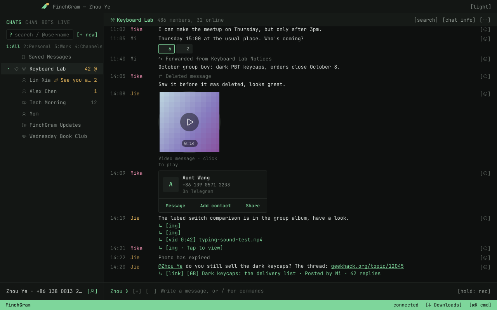

# FinchGram

[English](../README.md) · [简体中文](zh-Hans.md) · [繁體中文](zh-Hant.md) · [Español](es.md) · [Português](pt.md) · [Deutsch](de.md) · [Français](fr.md) · **Русский** · [日本語](ja.md) · [한국어](ko.md) · [العربية](ar.md)

**Настольный клиент Telegram с суперспособностями, на Rust и [Slint](https://slint.dev).** Открытый исходный
код под GPL-3.0. Сегодня — macOS на Apple silicon; Windows и Linux позже.

FinchGram общается с Telegram через [TDLib](https://core.telegram.org/tdlib), собственную библиотеку
Telegram, и соблюдает [условия API Telegram](https://core.telegram.org/api/terms). Это неофициальный
клиент, сделанный не Telegram.

## Что умеет

- **Telegram, как в его собственных приложениях.** Чаты с папками, поиском и до десяти аккаунтов; сообщения с ответами, реакциями, ботами, темами и черновиками; фото, видео, файлы и голосовые сообщения; управление вашими группами и каналами.
- **Инструмент снимков экрана.** ⌘⇧A замораживает экран: возьмите окно или область, нарисуйте поверх и отправьте. Из любого чата, как в WeChat.
- **Загрузки.** Клиент загрузок для ваших собственных серверов по WebDAV, FTP, FTPS или SFTP: NAS, сидбокс, PikPak. [Подробнее](../docs/downloads.md)
- **Музыка.** Плеер для ваших собственных серверов, говорящих на Subsonic API: Navidrome и подобных. [Подробнее](../docs/music.md)
- **Эфиры.** Owncast, PeerTube, Icecast и эфиры самого Telegram: находите, подписывайтесь и смотрите в приложении. [Подробнее](../docs/live-streams.md)
- **Голосовой ввод.** Говорите — слова попадают в поле ввода, через выбранного вами ИИ-провайдера и с вашим собственным ключом. [Подробнее](../docs/voice-input.md)
- **ИИ-ассистенты.** Claude и другие приложения с MCP читают ваши чаты и действуют в них через FinchGram, когда вы это разрешите. [Подробнее](../docs/mcp.md)
- **Три темы.** Workbench, Broadsheet и Terminal, у каждой светлая и тёмная сторона. В Terminal настоящая командная строка. [Как ей пользоваться](../docs/terminal.md)
- **Одиннадцать языков** и обновления, которые приложение ставит само, сначала проверив их.

[Всё, что он умеет, с картинками](../docs/features.md). Пока нет: секретных чатов и звонков, опросов и отложенных сообщений, фильтров по ключевым словам, Windows и Linux. См. [что дальше](../docs/architecture.md#not-now).

## Загрузка

Возьмите `FinchGram-<версия>-macos-arm64.zip` из [последнего релиза](https://github.com/FinchGram/FinchGram/releases/latest),
распакуйте и перенесите FinchGram в «Программы». Нужна macOS 12 или новее на Apple silicon. Приложение
подписано Developer ID компании North Brookville LLC и нотаризовано Apple, поэтому открывается как
любое другое. Дальше оно обновляется само.

Каждый релиз идёт с `SHA256SUMS` и его подписью Ed25519. Приложение проверяет и то, и другое перед
установкой обновления; можете и вы — открытый ключ в [release-signing.pub](../release-signing.pub).

## Три темы

| Workbench | Broadsheet | Terminal |
|---|---|---|
|  |  |  |

Workbench, тема по умолчанию, — рабочее окно с вкладками. Broadsheet читается как газета, с акцентным
цветом для каждого аккаунта. Terminal — моноширинный экран с командами. У каждой есть светлая и тёмная
сторона, вслед за системой или по вашему выбору, в Настройках › Оформление.

Terminal выполняет команды из строки внизу окна: нажмите ⌘K или введите `/`. Команды и клавиши — в [описании темы Terminal](../docs/terminal.md).

## Правила Telegram

FinchGram делает то, что делают приложения Telegram, и ничего из того, что они запрещают. Сообщение
отмечается прочитанным, когда вы его видите; собеседник видит, что вы печатаете и в сети, как в
любом приложении Telegram; спонсорские сообщения в каналах показываются; самоуничтожающиеся медиа
открываются один раз; ничто из Telegram не уходит ни в какой ИИ, если только вы не впустите
ассистента (Инструменты → Доступ для ИИ) или не включите расшифровку голосовых сообщений своим
ИИ-провайдером. С вашей машины ничего не уходит, кроме как в Telegram, ради обновлений на GitHub и, пока вы
пользуетесь голосовым вводом, ваш голос к выбранному вами ИИ-провайдеру под вашим собственным
ключом.

## Документация

Документы написаны на английском и китайском.

- [Что умеет FinchGram](../docs/features.md): каждая функция, с картинками.
- [Тема Terminal](../docs/terminal.md): её командная строка и команды.
- [Сборка из исходников](../docs/development.md), [структура репозитория](../docs/layout.md), [переводы](../docs/translations.md) и [релизы](../docs/releases.md).
- [Архитектура](../docs/architecture.md) и [соглашения](../docs/conventions.md): как это устроено и почему.

## Разработка

Приложение — оболочка: самим Telegram занимается TDLib, который работает отдельной программой рядом с ним и собирается этим репозиторием из закреплённых исходников, как libmpv и Skia. Для сборки нужны macOS на Apple silicon и собственный Telegram API ID; шаги описаны в [docs/development.md](../docs/development.md).

## Участие

Issues и pull requests приветствуются. Прежде чем менять то, как части стыкуются друг с другом,
прочитайте [docs/architecture.md](../docs/architecture.md) и
[docs/conventions.md](../docs/conventions.md): каждую зависимость этот репозиторий собирает из
зафиксированных исходников, интерфейс следует дизайну во всех трёх темах, и ничто в приложении не
идёт против условий API Telegram. Держите `cargo test`, `cargo clippy --all-targets` и
`cargo test screenshots -- --ignored` чистыми и смотрите на картинки. Картинки для README берутся из
того же теста: `scripts/readme-pictures.sh` обновляет `docs/screenshots/`.

## Лицензия

GPL-3.0 ([LICENSE](../LICENSE)). finchgram-tdlib содержит TDLib (Boost Software License 1.0) и
OpenSSL (Apache License 2.0); шрифты интерфейса распространяются по SIL Open Font License 1.1, значки —
по лицензии MIT. Тексты их лицензий поставляются вместе с приложением.
