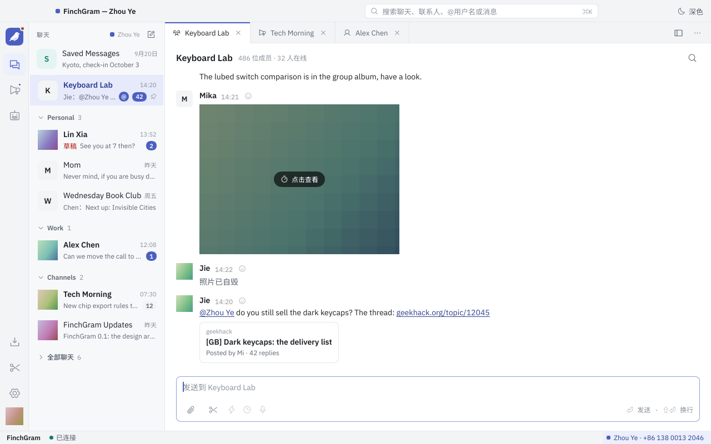
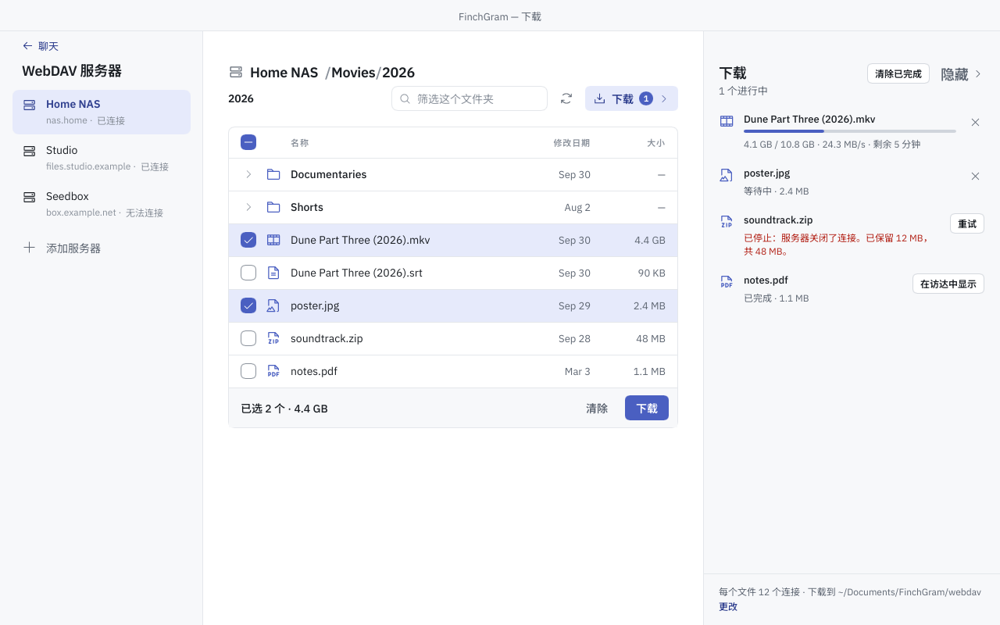

# FinchGram

[English](../README.md) · **简体中文** · [繁體中文](zh-Hant.md) · [Español](es.md) · [Português](pt.md) · [Deutsch](de.md) · [Français](fr.md) · [Русский](ru.md) · [日本語](ja.md) · [한국어](ko.md) · [العربية](ar.md)

<p align="center"></p>

**一个有超能力的 Telegram 桌面客户端，用 Rust 和 [Slint](https://slint.dev) 编写。** 开源，GPL-3.0 许可证。
现在支持 Apple silicon 的 macOS，Windows 和 Linux 以后做。

FinchGram 通过 Telegram 官方的库 [TDLib](https://core.telegram.org/tdlib) 和 Telegram 通信，并遵守
[Telegram API 条款](https://core.telegram.org/api/terms)。它是非官方客户端，不是 Telegram 出品的。

<p align="center"></p>

## 能做什么

- **聊天。** 用手机号、验证码和两步验证密码登录，或者扫二维码登录；也可以注册新账号。聊天列表带 Telegram
  的文件夹、置顶、未读数和 @ 提醒；全局搜索（⌘K）能找聊天和联系人、按用户名找公开的用户、群组和频道、按手机号找人，
  以及消息；还有聊天内搜索（⌘F）、频道视图和机器人视图。点铅笔可以新建群组、频道、私聊，或添加联系人。
  多账号，最多十个，每个账号各自一个 TDLib：在账号菜单里切换，或按 ⌘1 … ⌘0。
  管理群组和频道：头像、名字和简介、公开用户名或邀请链接、成员和管理员及其权限、成员权限、慢速模式、入群审批和话题；频道的签名和评论群。
- **消息。** 带格式的文字（粗体、斜体、代码、链接）、回复和转发、照片、视频、GIF、贴纸、文件，以及链接预览卡片。
  在消息上点右键打开它的菜单：回复、编辑、拷贝、拷贝链接、转发、举报、删除，或者选择多条。设为自毁的照片和视频
  打码显示、只能打开一次，和 Telegram 官方应用一样。机器人消息下面的按钮，以及机器人的键盘、命令和菜单按钮；
  聊天标题下面的置顶消息。保护内容的聊天在前台时，不会出现在截图和录屏里。表情回应，有选择器，双击就用默认的那个；
  圆形视频消息就地播放；联系人名片带“发消息”“添加联系人”和“分享”按钮；帖子或名片可以一次分享给多个聊天；
  草稿按聊天保存，跨设备同步；开了话题的群打开就是话题列表；慢速模式在输入框里倒计时；
  聊天设置栏里，成员看到群规则，管理员看到权限和选项。
- **媒体。** 照片和视频在盖住整个窗口的查看器里打开，可以翻看同一相册的其他图片；视频用从源码构建的 mpv
  播放。聊天允许时可以保存到“下载”。
- **下载。** 媒体中心里的下载客户端，走 WebDAV、FTP、FTPS 或 SFTP：你的 NAS、seedbox、PikPak、Alist/OpenList，或者用 `vget serve` 共享的
  文件夹，在 app 里直接浏览。文件多连接并发下载，停了能接着来；照片和视频下完直接在查看器里打开；密码封在 FinchGram
  的数据库里。见 [docs/downloads.zh-Hans.md](../docs/downloads.zh-Hans.md)。
- **发送。** 照片、视频和文件可以从回形针菜单发送，也可以拖进窗口或直接粘贴。发出去之前先在一张卡片里显示：
  可以加说明文字，按照片发或按文件发，最多十个合成一个相册，私聊里可以设自毁计时器，也可以静默发送。
- **截图。** 输入栏里的剪刀或 ⌘⇧A 会定住屏幕：取一个窗口或拖一个选区，画上方框、椭圆、箭头、画笔、文字和马赛克，
  然后直接发送、复制或保存。和微信一样，每个聊天里都有。
- **聊天菜单。** 静音、置顶、复制 ID、放进文件夹；拉黑或取消拉黑对方、举报、退出群组或频道、删除聊天。
  在文件夹上点右键，可以把里面的聊天全部标为已读，或者选择排序方式：按最新消息、按名称、按未读消息，
  置顶的始终在最前。
- **通知。** 新消息以 macOS 通知提醒，未读数显示在 Dock 图标上；关闭窗口后 FinchGram 留在 Dock 里，也可以住进菜单栏。
- **三套主题。** 工作台、报纸和终端，各有浅色和深色，切换不用重启。
- **设置。** 开机启动、按 Enter 发送、截图快捷键、通知的声音和预览、两步验证、界面语言，还有更新：app 从
  GitHub Releases 自动更新，验证不过的一律不装。
- **语音消息。** 在聊天里直接播放，带波形、时长和 1×、1.5×、2× 倍速；听过对方能看到，和 Telegram 官方应用一样。按住麦克风录音：松开发送，向左拖取消，向上拖锁定，锁定后可以停下来先试听再发。
- **语音输入。** 在输入框里按一下 ✦ 然后说话：去掉“嗯”“呃”之后，字进到输入框里，由你来发送。服务按 API 格式由你自己选，用你自己的密钥，愿意的话还可以填自己的地址（中转站，或局域网里的服务器）：OpenAI 的实时转写、通义千问和豆包（中文都很强），或任何支持 OpenAI 转写接口的服务；整理文字用 OpenAI、Anthropic 或 Gemini 的格式。每种主要语言一套设置，夹杂的其他语言照你说的原样保留。百宝箱 → AI → 语音输入，默认关着。语音消息下面的“转文字”用 Telegram 自己的转写，你打开开关后也可以用你自己的服务。见 [docs/voice-input.zh-Hans.md](../docs/voice-input.zh-Hans.md)。
- **AI 助手。** Claude Desktop、Claude Code 以及其他会说 Model Context Protocol 的应用，可以在你允许后通过 FinchGram 读你的聊天并代你操作：百宝箱 → AI 访问，默认关着，由你选哪些聊天、助手能不能发消息，应用第一次连接时会先问你。见 [docs/mcp.zh-Hans.md](../docs/mcp.zh-Hans.md)。
- **语言。** 界面和这份 README 都有十一种语言。

还没有的：秘密聊天和通话、投票和定时消息、关键词过滤、Windows 和 Linux。见
[接下来做什么](../docs/architecture.zh-Hans.md#现在不做)。

## 下载

从[最新的 release](https://github.com/FinchGram/FinchGram/releases/latest) 下载
`FinchGram-<版本>-macos-arm64.zip`，解压后把 FinchGram 拖进“应用程序”。需要 Apple silicon 的 macOS 12
或更新。app 用 North Brookville LLC 的 Developer ID 签名并经 Apple 公证，和其它 app 一样直接打开。之后它会自动更新。

每个 release 都带 `SHA256SUMS` 和它的 Ed25519 签名。app 装更新之前会先校验这两样；你也可以自己校验，公钥在
[release-signing.pub](../release-signing.pub)。

## 三套主题

| 工作台 | 报纸 | 终端 |
|---|---|---|
|  |  |  |

工作台是默认主题，一个带标签页的工作窗口。报纸读起来像报纸，每个账号有自己的强调色。终端是等宽字体的屏幕，
带命令。每套都有浅色和深色，跟随系统或自己选，在“设置 › 外观”里。

<p align="center"></p>

## 截图工具

<p align="center"></p>

按 ⌘⇧A，或者点回形针旁边的剪刀。屏幕定住，整屏压暗：拖一个选区，选区内不压暗，带放大镜和像素尺寸；
单击一个窗口则整个取下。工具条可以画方框、椭圆、箭头、画笔、文字和马赛克，三种粗细、六种颜色，可以撤销。
点 Done 把图放进发送卡片，可以配上说明文字；⌘C 复制；⌘S 存到“下载”。“设置 › 通用 › 截图”里可以改快捷键，
也可以决定截图时要不要先把 FinchGram 的窗口藏起来。

<p align="center"></p>

## AI 助手

<p align="center"></p>

FinchGram 是一个 MCP 服务端：你 Mac 上的 AI 助手应用（Claude Desktop、Claude Code、Cursor……）可以通过正在运行的 FinchGram、用你自己的账号读你的 Telegram 并在其中操作。百宝箱 → AI 访问 是开关，默认关着。在那里你选助手能看到哪些聊天（除秘密聊天外的全部，或只限选定的）、能写什么（以你的名义发消息、只留草稿由你发、或什么都不写），也能看到哪些应用连接过——名字是 macOS 报告的——以及它们要过什么。应用第一次连接时，FinchGram 会问你允不允许。读取不会标已读，秘密聊天永远不给看，也不为 AI 保存任何东西。页面上备好了贴进 Claude Code 或 Claude Desktop 的那一行；细节见 [docs/mcp.zh-Hans.md](../docs/mcp.zh-Hans.md)。

## 下载页面

<p align="center"></p>

显示 → 下载，或者齿轮上方的下载图标。添加一个服务器，WebDAV、FTP、FTPS 或 SFTP（NAS、seedbox、PikPak、Alist/OpenList、Nextcloud、
`rclone serve webdav`，或者用 `vget serve` 共享的文件夹），浏览它的文件夹，勾选文件或整个文件夹拿走，文件就到了
~/Documents/FinchGram/webdav：每个文件切成 8 MB 的块、最多十二条连接并发，重试时从停下的地方接着来，和维护者的命令行
工具 vget 一个做法。右边的队列显示速度和还剩多少；“打开”把照片或视频取下来后在查看器里显示。除非你为某台服务器允许，FinchGram 不会改动
服务器上的任何东西（允许后可以在那台上删除、移动、重命名、上传）；密码封起来进 FinchGram 的数据库，从不以明文写进文件。细节和还没做的部分见 [docs/downloads.zh-Hans.md](../docs/downloads.zh-Hans.md)
（自签名证书会被拒绝：局域网用 http，或者配正规证书）。

## 怎么做的

app 是一个外壳。Telegram 本身交给 TDLib，它作为一个独立程序跑在可执行文件旁边：`finchgram-tdlib`，由本仓库从锁定的
源码构建；外壳只通过 `src/telegram/` 跟它通信，用的是 TDLib 自己的 JSON。视频用同样方式构建的 libmpv 播放。
不从用户的机器上拿任何东西，构建时除了这些锁定并带校验和的产物之外什么也不下载。所有东西都公开：源码、vendor 构建
（`vendor/`）和发布。见 [docs/architecture.zh-Hans.md](../docs/architecture.zh-Hans.md) 和
[docs/conventions.zh-Hans.md](../docs/conventions.zh-Hans.md)。

## Telegram 的规矩

FinchGram 只做 Telegram 官方应用做的事，不做它们禁止的事。消息在你看到时标为已读，对方像在任何 Telegram 应用里一样
能看到你正在输入和在线，频道里的赞助消息照常显示，自毁媒体只能打开一次，来自 Telegram 的内容不会交给任何 AI，除非你在百宝箱 → AI 访问里放一个助手进来，或者打开了用你自己的服务把语音消息转文字。
除了 Telegram、用来更新的 GitHub，以及你用语音输入时以你自己的密钥发给你所选语音识别服务的声音，什么都不会离开你的机器。

## 开发

目前开发需要 Apple silicon 的 macOS：finchgram-tdlib 暂时只为它构建。Linux 和 Windows 以后再支持。

finchgram-tdlib、libmpv 和界面字体都不进 git：`vendor/tdlib/` 和 `vendor/mpv/` 里只放构建它们的脚本，
字体来自 Google Fonts。clone 之后先把它们拿下来一次：

```sh
scripts/fetch-tdlib.sh    # 把锁定的 finchgram-tdlib release 下载到 vendor/tdlib/bin/ 并校验 SHA-256
scripts/fetch-mpv.sh      # 把锁定的 libmpv release 下载到 vendor/mpv/bin/ 并校验 SHA-256
scripts/fetch-fonts.sh    # 把锁定的界面字体下载到 vendor/fonts/ 并校验 SHA-256
FINCHGRAM_API_ID=… FINCHGRAM_API_HASH=… cargo run
```

- 要修改 finchgram-tdlib 本身时，在本地构建它（几分钟；需要 Xcode 或 Command Line Tools，以及
  `brew install cmake ninja gperf`，都只是构建工具）：

  ```sh
  vendor/tdlib/build.sh && vendor/tdlib/build.sh install
  ```

- `FINCHGRAM_API_ID` 和 `FINCHGRAM_API_HASH`：用你自己的，在 [my.telegram.org](https://my.telegram.org)
  → API development tools 申请。它们在编译时读取，永远不进仓库。没有它们 app 也能启动，会提示没有 API ID。
- `FINCHGRAM_TEST_DC=1 cargo run` 连 Telegram 的测试服务器，那里有单独的账号；app 会为它另外保存一个数据库。
- `cargo test screenshots -- --ignored` 用假数据把每套主题的每个页面（浅色和深色）画成图片，存到
  `target/screenshots/`：不用登录账号也能看界面。

`build.rs` 把 `vendor/tdlib/bin/finchgram-tdlib` 复制到编译出来的可执行文件旁边，所以 `cargo run`
用的和打包后的 app 是完全同一个程序；它还从 `vendor/mpv/bin/` 链接 libmpv 并同样复制过去，`vendor/fonts/`
里的字体编译进可执行文件。缺了任何一样，编译都会直接失败并说明原因。需要 Rust 1.92 或更新。

TDLib 的数据库和下载的文件在 `~/Library/Application Support/FinchGram/tdlib/`，设置在
`~/Library/Application Support/FinchGram/settings.toml`。

## 目录

```
.github/workflows/
  mpv.yml                # 在干净的机器上构建 libmpv；mpv-* tag 发布成 release
  check.yml              # 每次 push 到 main 跑 clippy 和测试
  release.yml            # Release v* 提交时构建并发布 app
  tdlib.yml              # 在干净的机器上构建 finchgram-tdlib；tdlib-* tag 发布成 release
Cargo.toml
build.rs                 # 编译 ui/app.slint，打包 lang/，把 vendor/tdlib/bin/ 复制到可执行文件旁边
docs/                    # architecture.md、conventions.md、downloads.md、drag-and-drop.md、media-files.md、skia.md（以及中文版）
  screenshots/           #   README 里的图，来自截图测试（scripts/readme-pictures.sh）
lang/                    # 翻译：lang/<代码>/LC_MESSAGES/finchgram.po，编译进二进制
readme/                  # 这份 README 的其他语言版本
release-signing.pub      # 允许给 release 签名的公钥，编译进 app
scripts/
  bundle.sh              # 构建 dist/FinchGram.app（release 流程跑的就是它）
  fetch-fonts.sh         # 把锁定的界面字体下载到 vendor/fonts/
  fetch-mpv.sh           # 把锁定的 libmpv release 下载到 vendor/mpv/bin/
  fetch-tdlib.sh         # 把锁定的 finchgram-tdlib release 下载到 vendor/tdlib/bin/
  readme-pictures.sh     # 把 README 用的图从 target/screenshots/ 复制到 docs/screenshots/
  release.sh             # 发起一次 release：改版本、打 tag、push，其余交给 GitHub Actions
src/
  main.rs                # 窗口、设置、语言和主题、更新；启动 Telegram
  fonts.rs               # 界面字体，编译进可执行文件
  images.rs              # 消息里的图片，在界面线程之外解码
  telegram/              # 唯一跟 finchgram-tdlib 打交道的代码
    process.rs           #   运行这个程序：通过标准输入输出传递 TDLib 的 JSON
    api.rs               #   FinchGram 用到的 TDLib 类型（照锁定版本的 td_api.tl 写）
    mod.rs               #   请求和回复、重新启动；更新交给 store
    store.rs             #   TDLib 告诉我们的聊天、用户和消息；页面用的 model
    login.rs             #   登录、注册
    chats.rs             #   聊天列表
    conversation.rs      #   打开的聊天：消息、发送
    actions.rs           #   消息操作：右键菜单、回复、转发等
    account.rs           #   个人资料、退出登录
    password.rs          #   设置里的两步验证
    files.rs             #   下载文件
    avatars.rs           #   聊天和联系人的头像，代替首字母色块
    viewer.rs            #   媒体查看器：照片、视频、保存到“下载”
    rich_text.rs         #   带格式的文字：粗体、斜体、链接……
    notifications.rs     #   新消息通知、Dock 图标上的未读数
    online.rs            #   窗口在前台、有人在用时，账号是在线状态
  platform/              # 随操作系统而不同的部分
  player/                # 用 libmpv 播放视频，经 OpenGL 画进窗口
  screenshot/            # 截图工具：截取、覆盖层、标注、成图
  downloads/             # 下载页面：WebDAV、FTP、FTPS 和 SFTP，带多连接下载引擎
    remote.rs            #   三个客户端的同一张脸：列目录、检查服务器、取文件
    webdav.rs            #   PROPFIND 列目录、地址、Basic 认证
    ftp.rs               #   FTP 和 FTPS，用 suppaftp：单流，REST 接着下
    sftp.rs              #   SFTP，用 russh：多个会话分块下载，记住服务器密钥
    transfer.rs          #   一个文件分块多连接下载，停了接着来
    mod.rs               #   页面状态、线程、队列、服务器表单
  update.rs              # 自动更新：GitHub Releases、校验签名、替换、重启
  settings.rs            # 用户偏好（settings.toml）
  i18n.rs                # 界面语言：保存的选择，否则跟系统，否则英文
  screenshots.rs         # 把每个页面画成 PNG（cargo test screenshots -- --ignored）
  bin/                   # finchgram-release-sign.rs，release 背后的 Ed25519 签名工具
ui/
  app.slint              # 主窗口：菜单，以及显示哪个页面
  state.slint            # app 的状态，Rust 和页面共用
  telegram.slint         # Telegram 的内容：账号、登录、聊天、消息
  downloads.slint        # 下载页面的状态：服务器、文件夹、队列
  look.slint             # 当前主题的颜色、字体和形状，给共用页面用
  format.slint           # 按界面语言写出的日期、数量和消息类型
  widgets.slint          # 共用的小部件；chat.slint 是聊天窗口共用的部分
  viewer.slint           # 覆盖整个窗口的媒体查看器，三套主题各有样式
  pages/                 # 三套主题共用的页面：登录、设置、个人资料、下载
  workbench/             # 工作台主题的聊天窗口（默认）
  broadsheet/            # 报纸主题的聊天窗口
  terminal/              # 终端主题的聊天窗口
  icons/                 # Phosphor 图标（MIT），常规和双色两种；icons.slint 列出它们
  logo/                  # FinchGram 的 logo（svg、png）和使用规则
vendor/fonts/            # 不进 git：界面字体（scripts/fetch-fonts.sh）
vendor/mpv/              # libmpv：mpv 和 FFmpeg，用来播放视频
  build.sh               #   从锁定的源码构建它：版本和 SHA-256 都锁定在脚本顶部
  bin/                   #   不进 git：库本身（scripts/fetch-mpv.sh 下载，或 build.sh install）
vendor/tdlib/            # finchgram-tdlib
  build.sh               #   从锁定的源码构建它：TDLib commit、OpenSSL 版本和 SHA-256 都锁定在脚本顶部
  host/                  #   我们的小外壳程序（main.cpp）和它的 CMakeLists.txt
  bin/                   #   不进 git：app 用的程序（scripts/fetch-tdlib.sh 下载，或 build.sh install）
  work/, dist/           #   不进 git：本地构建的中间文件和打好的包
```

## 翻译

界面上的每一段文字都写成 `@tr("English text")`。同一个字符串在哪里出现都只有一个译法（build.rs 关掉了
Slint 的默认 context）；同一句英文在别处需要不同的译法时，给它一个 context：`@tr("menu" => "Open")`。
用官方工具提取，再合并进每种语言：

```sh
cargo install slint-tr-extractor                                          # 装一次
find ui -name '*.slint' | sort | xargs slint-tr-extractor --no-default-translation-context -o lang/finchgram.pot
for po in lang/*/LC_MESSAGES/finchgram.po; do msgmerge --update "$po" lang/finchgram.pot; done   # 需要 brew install gettext
```

然后填好 `msgstr`，重新 `cargo build`。英文是源语言；其余十种都带着。

## 发布

release 只由 GitHub Actions 在干净的机器上、从打了 tag 的 commit 构建（`.github/workflows/release.yml`），
发布在本仓库里：压缩好的 app、`SHA256SUMS` 和它的 Ed25519 签名。已安装的 app 从这里自动更新，
验证不过的一律不装。维护者用一条命令发起 release：

```sh
scripts/release.sh patch    # 0.1.0 -> 0.1.1；也可以是 minor、major 或一个具体版本号
```

app 用 North Brookville LLC 的 Apple Developer ID 签名，开启 Hardened Runtime，并经 Apple 公证：下载的 app 打开时
Gatekeeper 不会拦，app 自己安装的更新也一样。

## 参与

欢迎提 issue 和 pull request。改动东西之间的关系之前，先读 [docs/architecture.zh-Hans.md](../docs/architecture.zh-Hans.md)
和 [docs/conventions.zh-Hans.md](../docs/conventions.zh-Hans.md)：每个依赖都由本仓库从锁定的源码构建，界面在三套主题里
都照设计稿做，app 里没有任何违反 Telegram API 条款的东西。保持 `cargo test`、`cargo clippy --all-targets` 和
`cargo test screenshots -- --ignored` 干净，并且看一眼画出来的图。README 里的图也来自这个测试：
`scripts/readme-pictures.sh` 会刷新 `docs/screenshots/`。

## 许可证

GPL-3.0（[LICENSE](../LICENSE)）。finchgram-tdlib 包含 TDLib（Boost Software License 1.0）和
OpenSSL（Apache License 2.0）；界面字体采用 SIL Open Font License 1.1，图标采用 MIT 许可证。
它们的许可证文本都随 app 一起分发。
