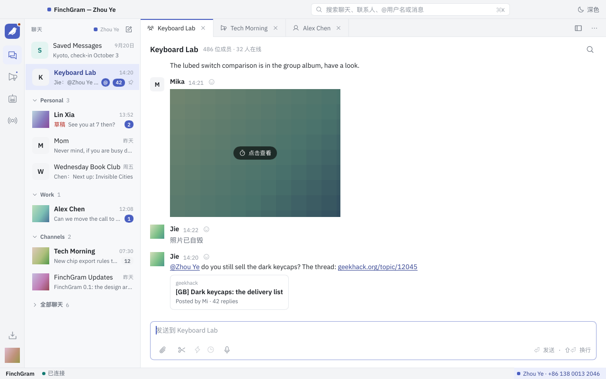
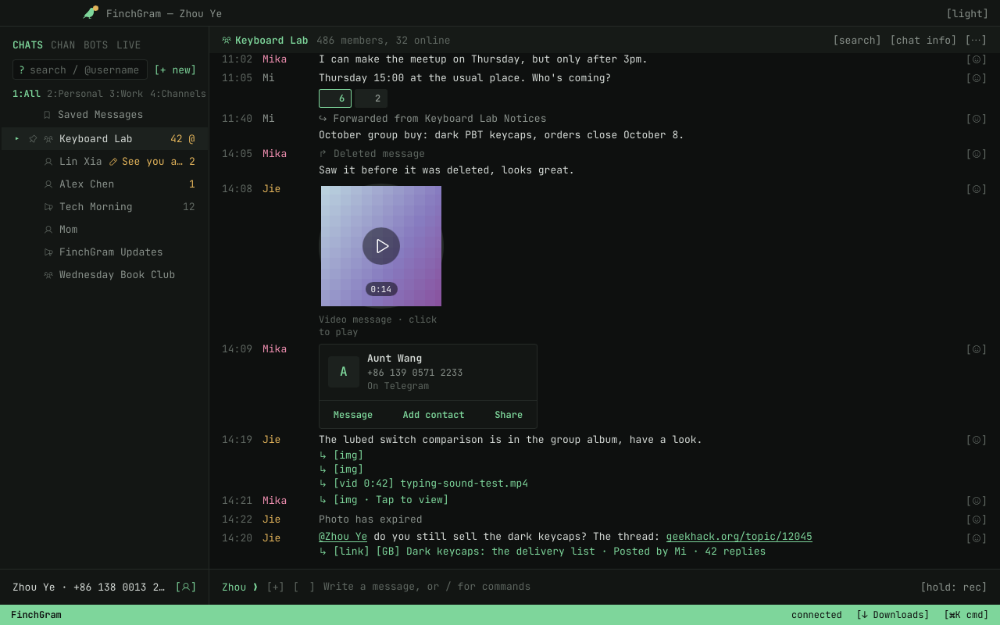

# FinchGram

[English](../README.md) · **简体中文** · [繁體中文](zh-Hant.md) · [Español](es.md) · [Português](pt.md) · [Deutsch](de.md) · [Français](fr.md) · [Русский](ru.md) · [日本語](ja.md) · [한국어](ko.md) · [العربية](ar.md)

**一个有超能力的 Telegram 桌面客户端，用 Rust 和 [Slint](https://slint.dev) 编写。** 开源，GPL-3.0 许可证。
现在支持 Apple silicon 的 macOS，Windows 和 Linux 以后做。

FinchGram 通过 Telegram 官方的库 [TDLib](https://core.telegram.org/tdlib) 和 Telegram 通信，并遵守
[Telegram API 条款](https://core.telegram.org/api/terms)。它是非官方客户端，不是 Telegram 出品的。

## 能做什么

- **Telegram 该有的都有。** 聊天、文件夹、搜索，最多十个账号；消息的回复、回应、机器人、话题和草稿；照片、视频、文件和语音消息；管理自己的群组和频道。
- **截图工具。** ⌘⇧A 定住屏幕：取一个窗口或拖一个选区，在上面标注，发出去。在每个聊天里都能用，像微信那样。
- **下载。** 一个下载客户端，连你自己的服务器，走 WebDAV、FTP、FTPS 或 SFTP：NAS、seedbox、PikPak。[详见](../docs/downloads.zh-Hans.md)
- **音乐。** 播放你自己服务器上的音乐，只要它讲 Subsonic API（Navidrome 等）。[详见](../docs/music.zh-Hans.md)
- **直播。** Owncast、PeerTube、Icecast 和 Telegram 自己的直播：发现、关注，就在 app 里看。[详见](../docs/live-streams.zh-Hans.md)
- **语音输入。** 对着输入框说话，走你自己选的 AI 服务商、用你自己的密钥。[详见](../docs/voice-input.zh-Hans.md)
- **AI 助手。** Claude 等支持 MCP 的应用，在你允许之后，通过 FinchGram 读你的聊天并在其中操作。[详见](../docs/mcp.zh-Hans.md)
- **三套主题。** 工作台、报纸和终端，各有浅色和深色。终端有一条真能用的命令行。[怎么用](../docs/terminal.zh-Hans.md)
- **十一种语言**，还会自己更新：先校验，再安装。

[全部功能，配图](../docs/features.zh-Hans.md)。还没有的：秘密聊天和通话、投票和定时消息、关键词过滤、Windows 和 Linux。见 [接下来做什么](../docs/architecture.zh-Hans.md#现在不做)。

## 下载

从[最新的 release](https://github.com/FinchGram/FinchGram/releases/latest) 下载
`FinchGram-<版本>-macos-arm64.zip`，解压后把 FinchGram 拖进“应用程序”。需要 Apple silicon 的 macOS 12
或更新。app 用 North Brookville LLC 的 Developer ID 签名并经 Apple 公证，和其它 app 一样直接打开。之后它会自动更新。

每个 release 都带 `SHA256SUMS` 和它的 Ed25519 签名。app 装更新之前会先校验这两样；你也可以自己校验，公钥在
[release-signing.pub](../release-signing.pub)。

## 三套主题

| 工作台 | 报纸 | 终端 |
|---|---|---|
|  |  |  |

工作台是默认主题，一个带标签页的工作窗口。报纸读起来像报纸，每个账号有自己的强调色。终端是等宽字体的屏幕，
带命令。每套都有浅色和深色，跟随系统或自己选，在“设置 › 外观”里。

终端主题在最下面那一行执行命令：按 ⌘K，或者输入 `/`。命令和按键见[终端主题](../docs/terminal.zh-Hans.md)。

## Telegram 的规矩

FinchGram 只做 Telegram 官方应用做的事，不做它们禁止的事。消息在你看到时标为已读，对方像在任何 Telegram 应用里一样
能看到你正在输入和在线，频道里的赞助消息照常显示，自毁媒体只能打开一次，来自 Telegram 的内容不会交给任何 AI，除非你在百宝箱 → AI 访问里放一个助手进来，或者打开了用你自己的 AI 服务商把语音消息转文字。
除了 Telegram、用来更新的 GitHub，以及你用语音输入时以你自己的密钥发给你所选 AI 服务商的声音，什么都不会离开你的机器。

## 文档

- [FinchGram 能做什么](../docs/features.zh-Hans.md)：每一项功能，配图。
- [终端主题](../docs/terminal.zh-Hans.md)：它的命令行和全部命令。
- [从源码构建](../docs/development.zh-Hans.md)、[仓库目录](../docs/layout.zh-Hans.md)、[翻译](../docs/translations.zh-Hans.md)、[发布](../docs/releases.zh-Hans.md)。
- [架构](../docs/architecture.zh-Hans.md)和[约定](../docs/conventions.zh-Hans.md)：它是怎么做的，为什么这么做。

## 开发

app 是一个外壳：Telegram 本身交给 TDLib，它作为独立程序跑在旁边，由本仓库从锁定的源码构建，libmpv 和 Skia 也一样。构建需要 Apple silicon 的 macOS 和你自己的 Telegram API ID；步骤见 [docs/development.zh-Hans.md](../docs/development.zh-Hans.md)。

## 参与

欢迎提 issue 和 pull request。改动东西之间的关系之前，先读 [docs/architecture.zh-Hans.md](../docs/architecture.zh-Hans.md)
和 [docs/conventions.zh-Hans.md](../docs/conventions.zh-Hans.md)：每个依赖都由本仓库从锁定的源码构建，界面在三套主题里
都照设计稿做，app 里没有任何违反 Telegram API 条款的东西。保持 `cargo test`、`cargo clippy --all-targets` 和
`cargo test screenshots -- --ignored` 干净，并且看一眼画出来的图。README 里的图也来自这个测试：
`scripts/readme-pictures.sh` 会刷新 `docs/screenshots/`。

## 许可证

GPL-3.0（[LICENSE](../LICENSE)）。finchgram-tdlib 包含 TDLib（Boost Software License 1.0）和
OpenSSL（Apache License 2.0）；界面字体采用 SIL Open Font License 1.1，图标采用 MIT 许可证。
它们的许可证文本都随 app 一起分发。
